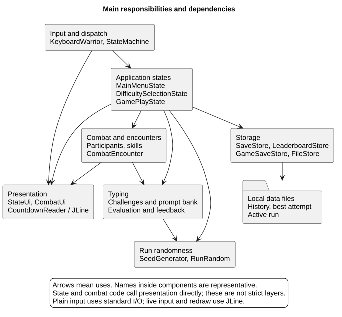
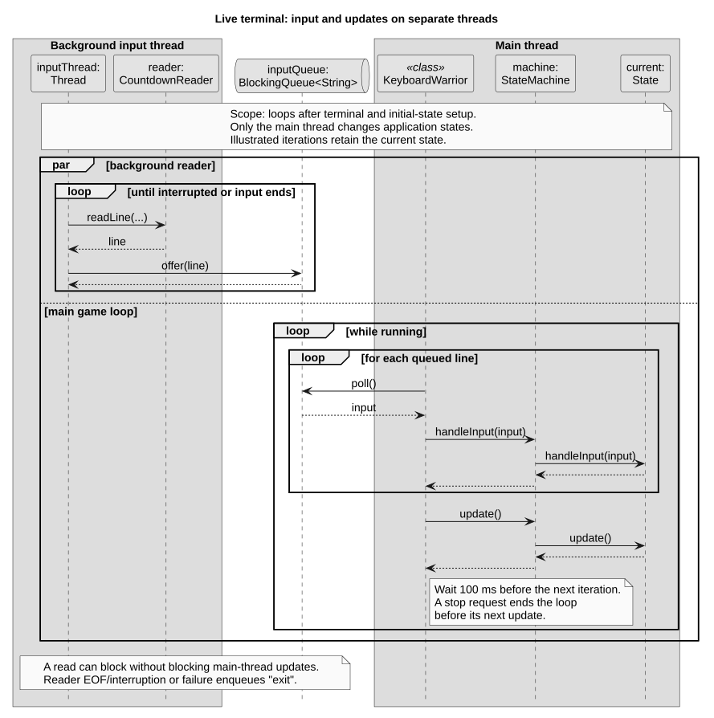
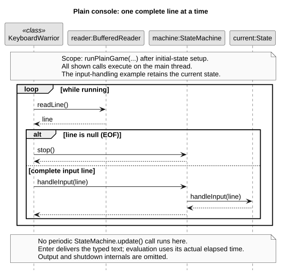
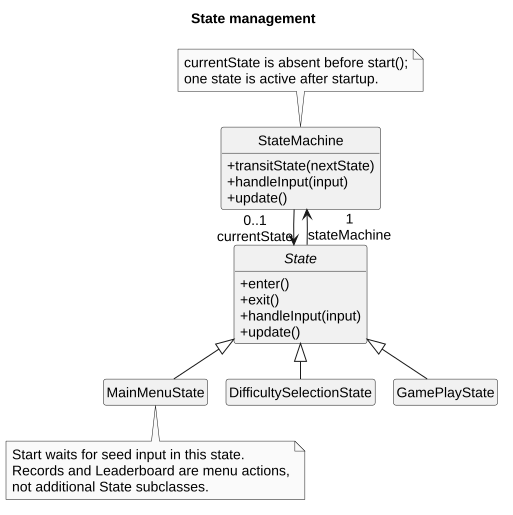
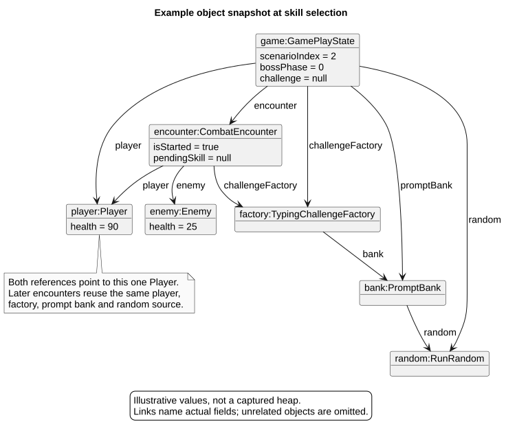
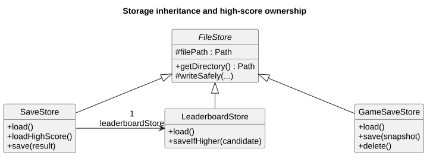
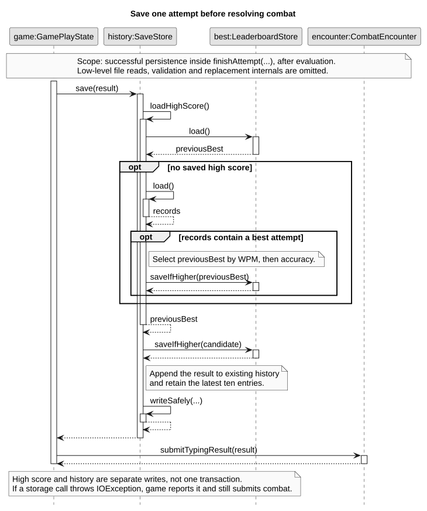
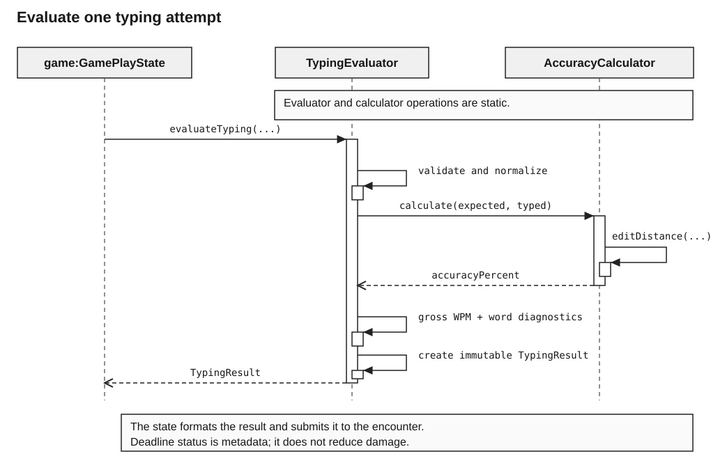
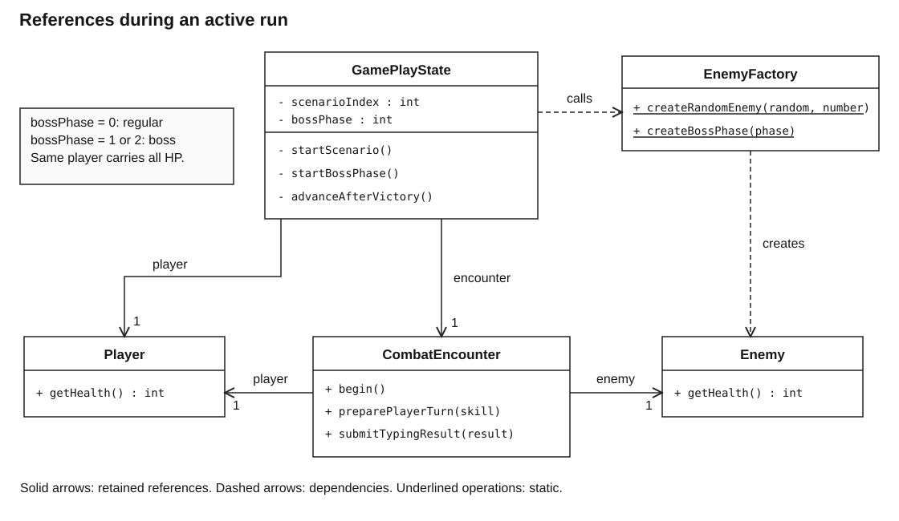
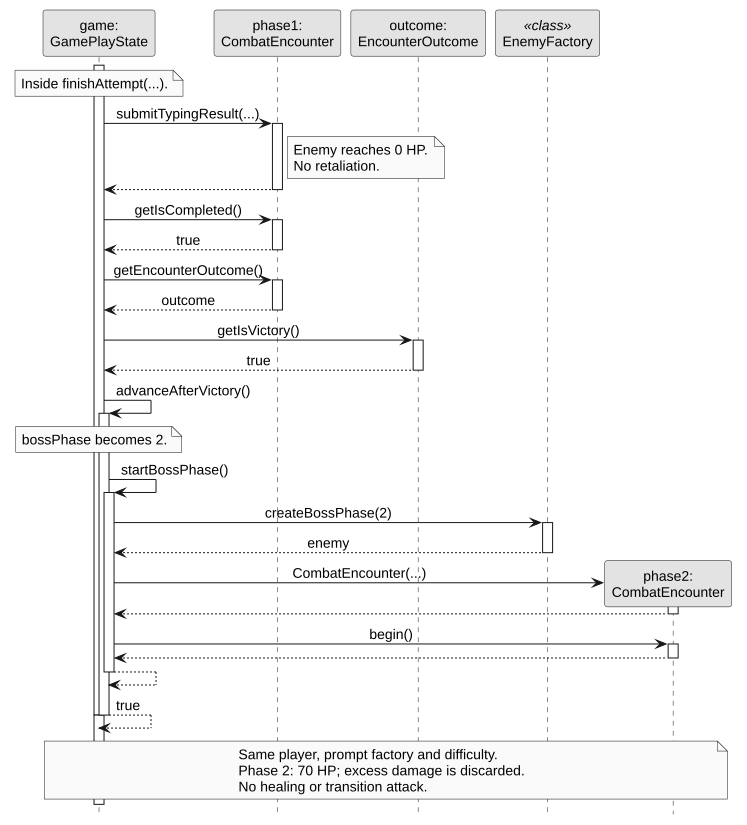

# Keyboard Warrior Developer Guide

## Acknowledgements

The project uses the [CS2113 tP starter template](https://github.com/NUS-CS2113-AY2627-S1/tp),
JLine for interactive terminal input and JUnit Jupiter for tests. Typing evaluation uses the Java
standard library.

## Design and implementation

### Architecture overview

`KeyboardWarrior` selects the input mode and drives a `StateMachine`. The active state coordinates
UI output, typing evaluation, one combat encounter and persistence. The diagram shows dependencies
between these responsibilities; it does not imply strict layers or MVC. Both the state machine
and concrete states call the UI directly.



[Editable PlantUML source](diagrams/architecture-overview.puml).

Typing evaluation measures performance without reading the terminal or applying damage. `combat` contains
participants, skills and damage rules; `encounter` manages turns. `storage` persists local files,
while `seed` supplies reproducible random choices. The following diagrams expand these boundaries
only where their internal structure or interaction matters.

### Runtime and terminal input

With a capable terminal, JLine and `CountdownReader` preserve edited input while displaying the
countdown. The background thread supplies complete lines through a queue; only the main thread
dispatches commands and updates the active state. Each main-loop iteration processes queued input,
calls `update()` and sleeps for 100 milliseconds. The sequence diagram omits prompt rendering and
shutdown handling to make that thread boundary visible.



[Editable PlantUML source](diagrams/runtime-input.puml).

If there is no native console or JLine cannot redraw it, plain mode uses the synchronous path below.
It waits for Enter without an automatic-expiry tick, because a buffered console may not deliver
unfinished text. The clock still measures actual elapsed time; late submitted text is evaluated
normally. Both modes start at the main menu and stop cleanly on `exit` or end-of-input.



[Editable PlantUML source](diagrams/plain-input.puml).

### State management

The state machine retains one current `State` and delegates `handleInput(...)` and `update()` to it.
`transitState(...)` exits the old state before entering its replacement. Concrete states keep their
own interaction rules; the menu's pending seed input is a flag, not a separate state class.



[Editable PlantUML source](diagrams/state-structure.puml).

Start accepts a seed before entering gameplay; Choose Difficulty returns to the menu with the
selected mode; Continue restores a saved run. Victory and defeat return to the menu. Records and
Leaderboard display results inside the existing menu and do not trigger a state transition.

### Source launchers and release startup

`run-game.bat` and `run-game.sh` first invoke Gradle's `prepareTerminalRun` task. That task depends on
`classes`, writes the runtime classpath and the build JVM's Java home, and does not create a JAR.
The launcher starts Java in the foreground with `-ea` and native access enabled. Direct terminal
input avoids Gradle `run` and IDE Run console stream redirection, which can prevent JLine from seeing
unsubmitted keystrokes. On Windows, the entry point selects the native Windows terminal type even
when the launcher supplies `TERM=dumb`.

These scripts are conveniences for a source checkout. The release is one executable fat JAR for
Windows, macOS and Linux and must start with Java 25 using `java -jar KeyboardWarrior.jar` without
Gradle or repository scripts. Its manifest includes `Enable-Native-Access: ALL-UNNAMED` for JLine's
bundled native support; this removes Java 25's native-access warning but does not create a terminal.

### Game difficulty selection

`GameDifficulty` is separate from `TypingChallenge.Difficulty`: it describes run modifiers rather
than passage content. Easy, Normal, Hard and Coder use multipliers 4, 2, 1 and 0.8 for player damage,
starting health and countdowns. Hard is the default to preserve the original balance.

`MainMenuState` accepts numbers 1-6 or the names Start, Records, Exit, Choose Difficulty, Continue and Leaderboard.
`DifficultySelectionState` accepts a mode number or name, then returns to a new menu with the same
`SaveStore` and selected mode. Invalid input leaves the selection menu active. Gameplay passes that
mode back to the menu after victory or defeat, preserving it for the session. The menu selection is
not saved separately, but the active run save includes its mode. Continue restores that mode.

`GamePlayState` creates the player with 400, 200, 100 or 80 HP and supplies the mode to the shared
`TypingChallengeFactory` and every `CombatEncounter`, including both boss phases. The factory applies
the countdown multiplier after calculating the normal base deadline and rounds up. Encryption uses
a base of 60 seconds, becoming 240, 120, 60 or 48 seconds. `SkillResolver` multiplies typing damage
before rounding down once. Automated enemy attacks keep their original base damage.

### Seeds and reproducible choices

After Start, `MainMenuState` treats the next line as a seed rather than a menu choice.
`SeedGenerator.parseSeed(...)` trims a nonblank line, parses it as a signed Java `long`, or uses
the trimmed string's `hashCode()` if numeric parsing fails. Blank input generates a fresh random
`long`. Text seeds are case-sensitive, and an out-of-range integer is handled as text. The resolved
numeric seed is displayed. At this prompt `exit` quits; `3` is a seed, not the menu's Exit shortcut.

One `RunRandom` supplies enemy and prompt choices, including Encryption. It follows Java `Random`'s
48-bit sequence. `snapshot()` stores its position and `restore(...)` resumes without replaying draws.
`PromptBank` separately remembers the previous passage at each difficulty to avoid immediate repeats.

The object diagram is an illustrative snapshot while choosing a skill, not an additional class
structure. The gameplay state and encounter reference the same player and challenge factory; the
bank and state share the generator. Replacing an encounter preserves these run-wide objects.



[Editable PlantUML source](diagrams/active-run-objects.puml).

Repeating the same seed and sequence of challenge requests reproduces choices in the same product
version. Different skills or turn counts consume different draws; typing performance is not fixed.

### Records and all-time leaderboard

#### Responsibilities and stored data

`SaveStore` retains the latest ten attempts, oldest first; its `LeaderboardStore` retains one best
attempt after history rotation. Each immutable `SavedRecord` contains WPM and character accuracy,
without a difficulty, seed, timestamp or player identifier. All runs using the same files share
these views; row numbers are display positions. Partial and zero-score attempts are eligible.



[Editable PlantUML source](diagrams/storage-structure.puml).

All three stores inherit safe replacement from `FileStore`. The menu and gameplay reuse the same
history store. Gameplay retains its run store; the menu creates one locally when Continue is chosen.
An injected history path also determines the sibling high-score path and the run-save directory.
Default files are relative to the launch directory:

| File | Contents | Retention |
| --- | --- | --- |
| `data/keyboardwarrior.txt` | UTF-8 lines in `wpm,accuracyPercent` format | Latest ten attempts, oldest first |
| `data/keyboardwarrior.txt.high-score` | Exactly one UTF-8 line in the same format | Best attempt until a better one is saved |

For example, a custom history path `test-data/history.txt` uses `test-data/history.txt.high-score`.
Neither file contains resumable game state; that belongs to `GameSaveStore`.

#### Saving attempts and preserving the best score

The sequence follows one evaluated attempt through history saving and combat. The nested
`loadHighScore()` call initializes the best available history entry before rotation if an
installation has no high-score file yet. File-format details are outside this store-level sequence.



[Editable PlantUML source](diagrams/history-saving.puml).

`LeaderboardStore.SCORE_ORDER` compares full-precision WPM first, then accuracy. Higher WPM wins
regardless of accuracy; higher accuracy wins when WPM is equal. Lower scores and exact ties leave
the high-score file untouched. For example, after `60,95`, an attempt of `50,100` cannot replace it,
`60,98` can, and `70,80` then becomes the best. The UI rounds values to two decimal places only for display.

`loadHighScore()` returns `Optional<SavedRecord>` and initializes from available history only when
the high-score file is absent. Attempts already discarded cannot be recovered. Once the high-score
file exists, reading it does not depend on history.

Both stores use `FileStore.writeSafely(...)`: write a complete temporary file in the destination
directory, then replace the destination with an atomic move where supported, or a regular replacement
move otherwise. Temporary files are cleaned up in `finally`. These are separate file writes, not a
transaction across both files. If updating the high score fails, history is not appended; if history
writing fails after the high score succeeds, the new best can remain saved without its history entry.
The gameplay state reports the `IOException` as a typing-history saving error and still resolves combat.

#### Menu display and error handling

`MainMenuState` trims commands and accepts option names case-insensitively:

| Command | Load and display flow |
| --- | --- |
| `2` or `records` | `SaveStore.load()` returns an immutable list, passed to `StateUi.showRecords(...)` |
| `6` or `leaderboard` | `SaveStore.loadHighScore()` selects `StateUi.showLeaderboard(SavedRecord)` or `StateUi.showEmptyLeaderboard()` through `ifPresentOrElse(...)` |

After results, an empty message or a loading error, `showMainMenu(difficulty)` redisplays all options
without changing state or difficulty. The state unwraps optional records before passing them to the
UI. `StateUi` routes output through the attached terminal or standard output in either input mode.

A missing history file produces an empty list. A missing high-score file triggers initialization;
if there is also no history, the leaderboard shows its empty message. Loaded WPM must be finite and
nonnegative, and accuracy must be finite and within 0-100. Each record needs exactly two fields, and
the high-score file must contain exactly one line. Malformed loaded data and unreadable files produce
`IOException`; an invalid high-score file is not silently overwritten or replaced from history.
`SavedRecord` itself has no validating constructor. `SaveStore.load()` validates the latest ten
history lines it returns, while `LeaderboardStore` validates loaded scores and candidates passed to
`saveIfHigher(...)`. Earlier lines in an oversized history file are ignored by `load()`.
Records reports `Could not load typing history: ...`; Leaderboard reports `Could not load leaderboard: ...`.

#### Design choices and alternatives

| Choice | Rationale | Alternative considered |
| --- | --- | --- |
| Separate persistent high score | Keeps the best attempt after history rotation and application restarts | Computing a maximum from the latest ten loses older best attempts; an in-memory maximum is lost on restart |
| Two numeric fields per record | Reuses existing typing metrics and a simple local file format | Keeping every attempt would allow broader statistics but requires unbounded history or a retention policy |
| Redisplay the existing menu | Preserves difficulty and storage without extra navigation state | A dedicated state would be useful if these views later gained interactive filtering or pagination |

### Active run saves

`GameSave` is an immutable record of a stable player turn: format version, game difficulty, current
player HP, zero-based scenario index, boss phase, enemy type identifier, current enemy HP, next
enemy skill index and an optional `RandomSnapshot`. Its constructor validates version, progression
combinations, health bounds and attack rotation against `EnemyFactory`.
Regular encounters use scenario indices 0-4 with boss phase 0;
the boss uses index 5 and phase 1 or 2. Dead participants cannot be saved.

`RandomSnapshot` holds the generator's internal position and an immutable copy of per-difficulty
previous passage indices. It validates the position through `RunRandom.restore(...)` and the indices
against a `PromptBank`. The original seed alone would restart the sequence rather than resume it.

`CombatEncounter.snapshot()` rejects calls before combat starts, during a pending typing attack,
or after completion. `begin(savedAttackIndex)` restores rotation without taking a turn.
`EnemyFactory.getTypeId(...)` supplies stable identifiers; loading recreates the exact enemy type
with its standard skills instead of rerolling it. `GameSave.restoreEnemy()` applies the saved HP.

`GameSaveStore` uses UTF-8 Java properties at `data/game-save.properties`, independently of typing
history and the leaderboard. For alternate history locations, run storage shares `SaveStore.getDirectory()`,
allowing tests to use `@TempDir` throughout. `GameSaveStore` extends `FileStore` and uses its
temporary-file replacement method, with an atomic move where supported and a regular replacement
move otherwise.
Invalid/missing fields and unsupported versions become `IOException`; an absent file means no run.
Runtime saves and temporary files are excluded from Git.

| Properties | Stored values |
| --- | --- |
| `version`, `difficulty`, `playerHealth` | Format version 1, game difficulty enum name and remaining player HP |
| `scenarioIndex`, `bossPhase` | Regular scenario 0-4 with phase 0, or scenario 5 with boss phase 1-2 |
| `enemyType`, `enemyHealth`, `nextEnemySkillIndex` | Stable opponent identifier, remaining HP and next attack rotation index |
| `randomState` | Unsigned 48-bit generator position for the next random draw |
| `previousPrompt.<DIFFICULTY>` | Last selected passage index for each passage difficulty already used |

The random fields are optional for compatibility with earlier version-1 saves. If neither
`randomState` nor any `previousPrompt.*` key exists, loading returns a legacy save without a
`RandomSnapshot`. A history key without `randomState`, an invalid difficulty/index or an invalid
generator position is rejected. A valid generator position with no history keys is allowed, such
as a save taken before the first passage is selected.

`GamePlayState.enter()` separates fresh-run initialization from restoration. The latter creates
fresh runtime objects, directly restores player HP and progression, then begins the restored
encounter at its saved rotation. It does not reapply the health multiplier or take an enemy turn.
For current saves, construction restores `RunRandom` and `PromptBank` history before selecting any
new passage or enemy. Legacy saves restore combat state but start with fresh randomness and empty
passage history, so their original future choices cannot be recovered.

Clock state, terminal objects and unfinished typed text are not serialized. Resuming an interrupted
challenge returns to its previous skill-selection point and restores that point's random state;
choosing the same skill again reproduces the interrupted passage for a current save. Its timer
starts again when that passage is shown.

Autosaves occur after encounter setup (including scenario/boss transitions) and after a surviving
enemy's response. No manual save command is exposed. Continue loads before transitioning states, so invalid saves
leave the menu usable. Start replaces the previous slot once the initial encounter is ready.
Victory and defeat remove it; Exit retains it. IO errors are reported while gameplay remains usable.

Regression tests cover reopening stores, all modes and boss phases, corrupt values, temporary-file
cleanup, exact random choices and enemy rotation after resume, interrupted attempts, new-run replacement,
progression, deletion after completion and combat continuing when storage fails.

Assertions check the internal save/restore boundaries: autosaves require a living player, an active
encounter, valid progression and no pending typing challenge. Combat snapshots check living participants
and attack rotation. Restoration asserts that health, opponent and next attack match the saved data.
File validation still uses exceptions because malformed saves must be rejected even without `-ea`.

### Typing evaluation and damage

#### Responsibilities and data flow

The typing package evaluates a completed input snapshot. It does not read the terminal, measure time,
apply damage or select an enemy. `GamePlayState` supplies expected text, current input, elapsed seconds
and required seconds to `TypingEvaluator.evaluateTyping(...)`. The returned `TypingResult` is immutable.
The state prints a summary and sends the same result to `CombatEncounter.submitTypingResult(...)`.
The encounter delegates damage to `SkillResolver`, preserving the boundary between measurement and combat.

| Class | Responsibility |
| --- | --- |
| `TypingEvaluator` | Validate and normalize the four inputs; coordinate metrics and retained word diagnostics |
| `AccuracyCalculator` | Compute character accuracy using Levenshtein edit distance |
| `WpmCalculator` | Compute gross WPM from normalized submitted character count and elapsed seconds |
| `WordErrorFinder` | Retain positional wrong, missing and extra word diagnostics for later features |
| `TypingResult` | Store full-precision metrics, supplied times and a defensive copy of word errors |
| `TypingResultFormatter` | Produce the short gameplay summary or optional detailed word report |
| `SkillResolver` | Convert WPM and character accuracy into player damage and apply health changes |
| `TypingChallengeFactory` | Select a skill's prompt and base deadline, then scale by the run difficulty |

The sequence follows the evaluator's collaborator calls after validation and normalization: retained
word diagnostics, gross WPM, character accuracy, then result construction. `<<class>>` participants
receive static calls; `result:TypingResult` is the newly created object. The caller, terminal,
formatting and combat are outside this diagram's scope. Edit-distance internals are explained below
rather than expanded into the same sequence.



[Editable PlantUML source](diagrams/typing-evaluation.puml).

#### Normalization and character accuracy

Both strings are normalized with `trim()` and `replaceAll("\\s+", " ")`. This removes leading and
trailing whitespace and collapses repeated internal whitespace. Capitalization and punctuation are
preserved. Let `expected` and `typed` denote those normalized strings.

```text
accuracyPercent = 100 * (1 - editDistance(expected, typed) / max(expectedLength, typedLength))
```

Edit distance is the minimum number of insertions, deletions and substitutions that transforms one
string into the other. `AccuracyCalculator` compares Unicode code points, so a supplementary character
counts as one character for accuracy. A deleted character is one edit rather than a shift that makes
every later character incorrect. Empty typed text is valid and produces zero accuracy; expected text
must remain nonempty after normalization, guaranteeing a positive denominator.

The implementation uses the usual dynamic programming recurrence. Each cell takes the minimum of
insertion, deletion and substitution cost. Only the previous and current row are retained, and the
shorter string occupies the columns. Runtime is `O(m * n)` and working memory is `O(min(m, n))` for
code point counts `m` and `n`. English challenge passages keep these inputs small. Evaluation compares
final text snapshots, so it cannot count mistakes that the player corrected before submission.

Word diagnostics remain separate from accuracy. `WordErrorFinder` still compares words at corresponding
positions and produces `WRONG`, `MISSING` and `EXTRA` entries. These entries are preserved for future
feedback; their count does not determine character accuracy. Gameplay uses `formatTypingSummary`,
which prints WPM, accuracy and the two times without the word list. `formatTypingResult` remains
available for detailed component inspection.

#### Speed, damage and time allowance

Gross WPM remains `(normalizedTyped.length() / 5.0) / (elapsedSeconds / 60.0)`. The existing WPM contract
uses Java `String.length()` (UTF-16 code units), whereas character accuracy uses code points. This
produces the same length for the intended ASCII English passages. Incorrect submitted characters and
normalized spaces count toward gross speed; Enter and discarded surrounding whitespace do not.

Player damage is now independent of the chosen skill's base damage:

```text
accuracyFraction = accuracyPercent / 100
playerDamage = floor(wpm * accuracyFraction^4 * gameDifficultyMultiplier)
```

`SkillResolver` calculates with full precision and rounds down once. On Hard, at 50 WPM and 95% accuracy this
is `floor(50 * 0.95^4) = 40`; at 50 WPM and 80% accuracy it is 20. The fourth power rewards accurate
input and limits the benefit of entering fast, unrelated text. A skill still chooses passage
difficulty. Its base damage continues to apply when the resolver receives no typing result for an
automated enemy attack. This preserves existing enemy skill rotations.

The countdown limits how long an attempt can remain open. For skills other than Encryption,
`TypingChallengeFactory` computes:

```text
minimumSeconds = 15 / 30 / 30 / 45 for Easy / Medium / Hard / Ultimate
baselineSeconds = normalizedPrompt.length() * 60 / (5 * 50)
requiredSeconds = max(minimumSeconds, ceil(baselineSeconds * 1.2))
finalSeconds = ceil(requiredSeconds * gameDifficultyMultiplier)
```

This gives a 50 WPM player a 20% time buffer while retaining the previous minimum allowances.
The buffer increases available typing time; it is not a damage multiplier. Required time therefore
varies by passage. `ChallengeClock` starts after prompt display. Skill selection and previous turn
feedback are outside the measured duration.

`CombatEncounter` calls `TypingChallengeFactory.generateForSkill(...)` so skills sharing a difficulty
can use different passages. Encryption remains Ultimate, with a base deadline of exactly 60 seconds
before applying the game difficulty multiplier.
`PromptBank.getEncryptionPrompt()` uses a randomly selected Ultimate passage's character count as
its target length, then generates random special characters in space-separated groups of one to six.
The resulting passage is between the target length and six characters longer. Other skills continue
to use the difficulty-based generator above.

Both Enter and live-terminal automatic expiry use the same evaluator. At expiry, `GamePlayState.update()` obtains
`StateUi.takeCurrentInput()` before clearing the editable line and resolving the attempt. The actual
elapsed duration is supplied, so captured partial text retains its measured WPM and accuracy.
`isTimeLimitExceeded()` reports the strict comparison `elapsedSeconds > requiredSeconds`. It is
metadata: overdue attempts receive no additional damage reduction. The retained compatibility getter
`getTimeDamageMultiplier()` returns `1.0`; player damage does not depend on it.
Plain mode does not call the automatic-expiry update tick; `handleInput(...)` evaluates the line
when Enter arrives, retaining actual elapsed time even after the displayed deadline.

#### Validation and defensive checks

Null text or dependency references cause `NullPointerException`. Blank normalized expected text,
nonpositive or nonfinite times and out-of-range result metrics cause `IllegalArgumentException`.
Empty player text is a valid zero-score attempt. Result fields are immutable; word error lists are
copied and exposed as unmodifiable lists. `WordError` positions begin at 1 and use an empty string
for an absent word.

Assertions check computed accuracy bounds, finite nonnegative WPM, edit distance bounds and health
updates. Public argument checks remain active without `-ea`. The state clears its active challenge
before completing a turn, and the encounter requires exactly one pending skill before accepting a
result. A duplicate result or invalid turn sequence causes `IllegalStateException`, preventing
accidental double attacks. Existing `FINE` logging records combat events without cluttering gameplay.

#### Design choices and alternatives

| Choice | Rationale | Alternative considered |
| --- | --- | --- |
| Character edit distance | Local insertions and deletions produce local accuracy costs | Positional word matching can mark the rest of a passage wrong after one omitted word |
| Two-row dynamic programming | Retains the exact score with bounded working memory | A full matrix stores every cell and is only useful if a later feature needs an edit trace |
| Fourth-power accuracy factor | Makes careful typing matter while keeping one formula across skills | Linear accuracy penalizes fast inaccurate text less; skill base multipliers make equal typing performance deal different damage |
| Length-based deadline with a minimum | Makes longer passages achievable at the balance target | One fixed deadline per skill can demand very different WPM from randomly selected passages |
| Deadline as metadata | Capture still ends the turn, without a second score reduction | An extra late multiplier obscures the direct relationship between text, speed and damage |

### Combat model and encounter lifecycle

The combat package defines mutable participants and immutable skill definitions. `CombatEncounter`,
`Encounter` and `EncounterOutcome` provide the combat lifecycle; no other encounter type participates
in the gameplay flow described here.

| Class | Responsibility |
| --- | --- |
| `combat.Entity` | Store a participant's display name, nonnegative HP, defeated flag and active skills |
| `combat.Player` | Create the player with the five standard skills in display order |
| `combat.Enemy` | Represent an opponent whose loadout is supplied by a factory |
| `combat.Skill` | Store a skill's display name, nonnegative base damage and typing difficulty |
| `combat.SkillRegistry` | Own the shared skill definitions and resolve stable skill identifiers |
| `combat.EnemyFactory` | Build registered enemies, scenario-scaled opponents and both boss phases |
| `combat.SkillResolver` | Calculate typed player damage or use base damage for automated enemy attacks, then clamp HP at zero |
| `encounter.Encounter` | Define `start()`, display text, completion state and guarded outcome access |
| `encounter.EncounterOutcome` | Store the final victory flag; it defaults to `false` until completion |
| `encounter.CombatEncounter` | Enforce turn order, generate player challenges, rotate enemy attacks and finalize victory or defeat |

`Entity` rejects null or blank names and negative HP. Skills cannot be null, and `Skill` similarly
rejects blank names, negative base damage and null typing difficulties. The active-skill collection
is ordered: the player receives Ping, Brute Force, Buffer Overflow, SIGKILL and Encryption. Registry
lookups use the lowercase identifiers below and reject an unknown identifier.

| Identifier | Display name | Base damage | Typing difficulty |
| --- | --- | --- | --- |
| `ping` | Ping | 10 | Easy |
| `brute_force` | Brute Force | 20 | Medium |
| `buffer_overflow` | Buffer Overflow | 40 | Hard |
| `sigkill` | SIGKILL | 80 | Ultimate |
| `encryption` | Encryption | 80 | Ultimate |

Base damage is used when `SkillResolver.execute(...)` receives a null `TypingResult`, which is the
automated enemy-turn path. A player turn supplies a result and instead uses the WPM/accuracy formula
described in the Typing evaluation and damage section. Consequently, selecting a higher-base-damage player skill does not
directly increase player damage; it selects a different typing challenge.

`EnemyFactory.createEnemy(type)` provides the registered identity and attack rotation. Its default HP
is useful for direct construction, while `createScenarioEnemy(...)` and
`createRandomEnemy(random, scenarioNumber)` replace it with the current scenario's 30/35/50/60/70 HP.
Enemy identifiers are normalized with `Locale.ROOT`, keeping lookup independent of the host locale.

| Type identifier | Display name | Default HP | Repeating attack rotation |
| --- | --- | ---: | --- |
| `rogue_ai` | Script Kiddie | 80 | Ping, Brute Force, Buffer Overflow |
| `malware_bot` | Malware Bot | 120 | Ping, Brute Force |
| `firewall_golem` | Firewall Golem | 90 | Ping, Buffer Overflow |
| `cache_goblin` | Cache Goblin | 80 | Ping, Brute Force |
| `phantom_packet` | Phantom Packet | 90 | Ping, Buffer Overflow |
| `cipher_serpent` | Cipher Serpent | 100 | Brute Force, Buffer Overflow |
| `trojan_knight` | Trojan Knight | 110 | Ping, Brute Force |
| `null_dragon` | Null Dragon | 120 | Brute Force, Buffer Overflow |

Boss creation is separate: phase 1 has 50 HP and repeatedly uses Ping for 10 damage, while phase 2
has 70 HP and repeatedly uses Brute Force for 20 damage. `getTypeId(...)` converts configured regular
enemies back to their stable identifiers and maps either boss phase to `kernel_overlord` for saving.

A `CombatEncounter` can run synchronously through `start()`, or the state machine can use its split
API so countdown updates remain nonblocking:

1. `begin()` announces combat and opens the first player turn. `begin(savedIndex)` restores the next
   enemy attack without taking an extra turn.
2. `preparePlayerTurn(skill)` verifies that combat is active and the player owns the skill, generates
   one challenge, and records exactly one pending skill.
3. `submitTypingResult(result)` resolves that skill. A lethal player attack completes victory before
   retaliation; otherwise the enemy uses its next base-damage skill and advances its index modulo the
   loadout size.
4. A lethal enemy attack completes defeat. If both participants remain alive, the encounter displays
   the next player turn.

Only one result can resolve each prepared turn. Calls made before `begin()`, after completion or while
another skill is pending fail with `IllegalStateException`. `Encounter.getEncounterOutcome()` is also
unavailable before completion. On completion, combat marks the defeated entity, sets the outcome and
sets `isCompleted`; gameplay advances only after reading a completed victorious outcome.

`CombatEncounter.snapshot()` is deliberately narrower than the encounter itself. Between stable
turns it returns the enemy type, remaining HP and next attack index. It rejects snapshots before
combat starts, while a typing result is pending or after combat completes, preventing a save from
representing a partially resolved turn.

### Scenario progression and two-phase final boss

#### Run structure and ownership

A run starts with one `Player` at the selected mode's starting HP (100 on Hard), passes through five regular
scenarios and ends with two
phases of the Kernel Overlord. Defeating scenario 5 starts the boss rather than winning the run.
Only victory against boss phase 2 triggers the run victory message and return to the main menu.
Player defeat at any point ends the run immediately. A new `start` creates a new player and resets
scenario, phase and challenge state.

`GamePlayState` coordinates progression; `CombatEncounter` continues to resolve only one enemy at a
time. This keeps the existing combat boundary intact. `scenarioIndex` tracks regular scenario
progress, while `bossPhase` is `0` during regular scenarios and `1` or `2` during the boss. The private
helpers `startScenario()`, `startBossPhase()` and `advanceAfterVictory()` separate encounter creation
from transition decisions. `StateUi.showBossPhase(phase, total)` announces the phase without putting
combat rules into the UI.

The class diagram shows references and creation dependencies during active gameplay; old encounters
are replaced during progression. Target-end role names match stored fields, while dashed arrows
denote temporary dependencies. The diagram omits unrelated UI, skill and clock classes.



[Editable PlantUML source](diagrams/run-progression.puml).

`EnemyFactory.createRandomEnemy(random, scenarioNumber)` accepts a one-based number from 1 to 5.
It chooses an existing enemy type and skill rotation, then sets health from the scenario table.
Random names therefore retain variety without changing how many successful attacks the balance
target needs. The overloads that create named or unrestricted random enemies remain usable by
sample code and component tests.

`EnemyFactory.createBossPhase(phase)` accepts only phase 1 or 2 and returns a fresh enemy named for
that phase. Phase 1 has 50 HP and a fixed 10-damage attack; phase 2 has 70 HP and a fixed 20-damage
attack. Each phase uses a new `CombatEncounter` with the existing player and shared prompt factory.
The first phase's dead enemy object is not revived or repurposed.

#### Transition ordering and phase boundaries

`CombatEncounter.submitTypingResult(...)` resolves the player's attack first. If enemy HP reaches
zero, it completes victory and returns before executing an enemy turn. Otherwise the enemy attacks;
player defeat is checked before the next turn is offered. `GamePlayState` inspects the completed
encounter and advances only on victory. It does not infer success merely because a challenge ended.

The sequence covers a lethal phase-1 attack through the creation of phase 2. Nested activation bars
follow the real `advanceAfterVictory()` and `startBossPhase()` calls; phase changes are explained in
a note rather than appended to a method label. The factory is a class-level participant and the
new encounter is an object. UI and persistence calls are outside this transition's scope.
Abbreviated constructor arguments include the same player, enemy, UI, shared factory and difficulty.



[Editable PlantUML source](diagrams/boss-phase-transition.puml).

The same player reference carries remaining HP into the next encounter. Neither a regular scenario
transition nor a boss phase transition heals the player or triggers an extra enemy attack. Damage
is clamped at zero HP on the current target; any excess is discarded. For example, dealing 60 damage
to a phase with 10 HP remaining defeats that phase, then phase 2 begins with its full 70 HP.
A very strong attack cannot skip phase 2 or immediately win.

A timeout uses this same sequence. Nonempty captured input can deal damage, including a lethal
attack. An empty or inaccurate input can deal zero damage and still consume a turn. If the enemy
survives and its response brings player HP to zero, the state returns to the menu without starting
a later scenario or phase.

#### Balance target and verification

The Hard-mode balance target is 50 WPM and at least 95% character accuracy, yielding at least 40 damage per
attempt. The table counts attacks and possible retaliation at exactly 40 damage. Regular enemies
retain their usual skill rotation; the highest first attack among those rotations is 20 damage.
Enemies requiring one attack do not retaliate, and those requiring two only use their first attack.

| Encounter | HP | Player attacks | Maximum retaliation damage |
| --- | --- | --- | --- |
| Scenario 1 | 30 | 1 | 0 |
| Scenario 2 | 35 | 1 | 0 |
| Scenario 3 | 50 | 2 | 20 |
| Scenario 4 | 60 | 2 | 20 |
| Scenario 5 | 70 | 2 | 20 |
| Boss phase 1 | 50 | 2 | 10 |
| Boss phase 2 | 70 | 2 | 20 |
| **Total** | | **12** | **90** |

Thus a target-performance player finishes even the strongest possible regular enemy selection with
at least 10 of the original 100 HP. Random enemy selection cannot invalidate this bound. It is a
balance guarantee for the stated performance, not for arbitrary typing: an additional low-damage
turn can expose a later, stronger enemy skill and lead to defeat. The HP progression introduces
extra turns gradually, and the boss tests the same typing mechanics with a clear phase transition.

#### Validation, invariants and alternatives

The factory rejects invalid scenario numbers and boss phases with `IllegalArgumentException` and
null random sources with `NullPointerException`. Generated enemies must have positive HP and usable
skill loadouts. Combat entities reject invalid health, and the resolver clamps damage at zero HP.
The encounter guards start/prepare/submit sequencing with exceptions and checks living-participant
assumptions through assertions. State and combat diagnostics remain hidden at normal logging levels.

Progression must preserve these invariants: one live player per run; at most one active challenge;
only a completed victorious encounter advances; regular indices stay in the five-scenario range;
boss phase remains 0, 1 or 2; and no run victory occurs before phase 2 is defeated. Resetting all
progression state on entry prevents a new run from inheriting the previous boss phase.

| Choice | Rationale | Alternative considered |
| --- | --- | --- |
| Keep progression in `GamePlayState` | The state already owns the run and its transitions | A separate campaign manager adds another coordinator for a short fixed sequence |
| Reuse `CombatEncounter` per phase | Existing turn ordering and death checks apply unchanged | A special boss encounter subclass duplicates combat logic and increases testing scope |
| Create a fresh enemy for each phase | Fresh HP and loadout have explicit phase boundaries | Mutating a dead enemy risks retaining death flags, pending skills or rotation indices |
| Discard overkill and prohibit transition attacks | Every phase has a predictable initial state | Carrying overflow or adding a transition attack makes timing and difficulty less transparent |
| Set HP by scenario and preserve random identities | Progression is reproducible while encounters remain varied | Unrestricted random HP makes some runs substantially harder at equal typing performance |

### Defensive programming and diagnostics

Assertions expose internal programming errors during development; public validation uses exceptions
and remains active when assertions are disabled. Gradle enables assertions for `run` and `test`,
and the gameplay launchers pass `-ea`. Direct IntelliJ Application configurations should add `-ea`
in **VM options**. See the [README setup steps](../README.md#setting-up-in-intellij).

Diagnostics use `java.util.logging`. Combat events and state transitions use `FINE`, hidden at the
default level. Terminal initialization and input failures use warning or severe levels. This gives
maintainers failure context without filling the typing area with routine debug messages.

## Product scope and requirements

The target users are players who want English typing practice through short combat encounters.
Keyboard Warrior makes speed and accuracy visible through damage and provides a complete run with
regular progression and a final boss.

| Feature | As a player, I want to ... | So that ... |
| --- | --- | --- |
| Typing feedback | receive character accuracy and WPM feedback | one local typo has a proportional accuracy cost |
| Typing damage | deal damage from speed and accuracy across all skills | I can understand how my typing affects combat |
| Timed input | retain my current input when time expires | unfinished typing still contributes to my attempt |
| Scenario progression | face progressively tougher regular scenarios | the run builds up difficulty predictably |
| Final boss | fight a final boss with two phases | the run has a clear final challenge before victory |
| Difficulty | choose Easy, Normal, Hard or Coder | health, damage and typing allowances suit my ability |
| Seeds | enter a seed when starting a run | I can repeat random choices with the same gameplay sequence |
| Continue | resume the last stable turn after restarting | remaining health, progression and future random choices are retained |
| Records | review my latest ten attempts in chronological order | I can compare recent typing performance |
| Leaderboard | retain my best attempt across runs and restarts | I have a lasting score to improve on |

Non-functional requirements:

* Build, run and test with Java 25.
* Return deterministic metrics and damage for the same texts and supplied times.
* Keep evaluation independent of terminal input, timing and scenario progression.
* Retain immutable results and reject invalid integration data before changing combat state.
* Keep gameplay usable in a supported terminal while countdown updates preserve input.
* Start from one standalone JAR on Windows, macOS and Linux, with plain input/output when no live terminal is available.

Glossary:

* **Gross WPM**: Five normalized submitted UTF-16 code units count as one word, including incorrect input.
* **Character accuracy**: One minus normalized character edit distance, expressed as a percentage.
* **Edit distance**: Minimum count of character insertions, deletions and substitutions.
* **Overkill**: Damage beyond the current target's remaining HP; discarded at encounter boundaries.
* **Phase**: One boss enemy configuration with its own HP and attack, resolved as one combat encounter.

## Testing

### Automated checks

Run `./gradlew check` on macOS/Linux or `.\gradlew.bat check` in Windows PowerShell with Java 25.
This builds the executable JAR, runs JUnit (including packaged-JAR smoke tests) and runs Checkstyle.
Tests live under `src/test/java/seedu/keyboardwarrior`.

Packaged-JAR smoke tests start Java 25 subprocesses in temporary working folders with redirected
input/output. They verify that the actual release artifact displays the menu, processes commands
and closes cleanly on `exit` or EOF without the unsupported-console shutdown or native-access warning.
This covers application startup, which direct UI-component tests do not exercise.

The relevant regression checks cover character substitution/insertion/deletion, normalization,
capitalization and punctuation, empty input, invalid values and immutable diagnostic lists. Formatter
tests check four summary metrics and retained detailed word reports without a timing penalty line.
Damage tests check the fourth-power formula, rounding, skill independence, empty input and unchanged
enemy base attacks. Factory and gameplay tests cover scenario HP, both boss loadouts, HP carryover,
phase boundaries, defeat and restart. Clock and terminal tests cover countdown output and captured
unfinished input. Simulated terminal tests select JLine's `exec` provider for consistent stream-based
input/output on Windows, macOS and Linux.

Storage tests verify both file contents and loaded records, retention after reopening, and invalid
metric rejection. State integration tests check that starting and finishing a run retain the same
history store. Enemy lookup is also tested under a Turkish default locale so case normalization
cannot depend on the operating system's language.

Records and leaderboard regressions use stores under `@TempDir`, so they do not alter the player's files:

| Test class | Coverage |
| --- | --- |
| `storage.SaveStoreTest` | Latest-ten chronological retention, reopening, invalid metrics and unusable storage paths; all-time best survives rotation and is replaced by a faster attempt; legacy history migrates before its best record is discarded |
| `storage.LeaderboardStoreTest` | Missing file, first zero score, higher WPM and accuracy tie-breaks; lower scores and exact ties preserve file contents and modification time; malformed scores are reported and left unchanged |
| `state.MainMenuStateTest` | Records and leaderboard results, empty data and loading errors; leaderboard text and numeric commands; one best entry after history changes; full menu redisplayed after results or errors and subsequent commands remain usable |
| `state.GamePlayStateTest` | The returned menu reads the same history store after a run, and combat continues when saving fails |

In particular, `highScore_rotatedHistory_retainsBestUntilHigherAttempt` saves a best attempt, then
twelve slower attempts through reopened stores, and verifies that a faster attempt finally replaces it.
`highScore_existingHistory_preservesBestBeforeFirstRotation` checks migration from a full legacy history
and verifies that the persisted best remains readable even when the history file is subsequently absent.

Seed and save regressions cover the continuation contract:

* `seed.RunRandomTest` compares draws with Java `Random`, including rejection sampling, and checks restoration without replaying earlier draws.
* `storage.GameSaveStoreTest` checks random-state and passage-history round trips, legacy saves and malformed fields, as well as combat fields and safe replacement.
* `save_resumeAtEveryScenarioAndBossPhase_matchesUninterruptedSeededRun` compares resumed and uninterrupted choices at every encounter boundary, including Encryption passages.
* `save_resume_restoresHealthDamageAndNextEnemyAttackWithoutReplayingATurn` checks a quit during typing retains the stable turn and that resuming preserves HP and the next enemy attack.
* `handleInput_sameSeed_repeatsRunAndRetainsHistory` checks replay through the menu without clearing typing history.

The progression regressions in `GamePlayStateTest` include:

* `normalPerformance_eachRepeatedEnemyType_survivesFiveScenariosAndBothBossPhases` checks the balance target across each regular enemy type.
* `bossPhaseTransition_preservesPlayerHealthAndDiscardsOverkillWithoutRetaliation` checks the phase boundary.
* `bossPhaseOne_playerDefeat_returnsToMenuWithoutStartingPhaseTwo` and `bossPhaseTwo_playerDefeat_returnsToMenuWithoutVictory` check defeat in either phase.
* `update_liveCountdown_scoresUnsubmittedAnswerAndPreservesTimerOrder` checks unfinished input and countdown placement.

### Manual gameplay acceptance tests

For the live-countdown checks, use a supported terminal with Java 25 and the release JAR.
The optional `sh ./run-game.sh` or `.\run-game.bat` launchers are alternatives for a source checkout.

| Test | Steps | Expected result |
| --- | --- | --- |
| Standalone JAR launch | Run `java -jar KeyboardWarrior.jar` with only the JAR and Java 25 available | Menu appears without requiring Gradle or a source launcher |
| Redirected launch | Launch the JAR with piped `exit` input, then with empty input | Plain-text menu appears and both runs exit cleanly without terminal setup warnings |
| Plain-mode late input | In an IDE Run console, start a challenge, wait past its displayed allowance and submit a partial passage with Enter | Passage remains visible while waiting; submitted text is scored using actual elapsed time; no empty turn is submitted before Enter |
| Countdown and skill allowance | Start a run; choose each skill across several passages | Timer stays above the passage and updates while typing; ordinary skills use length-based allowances with minimums, while Encryption uses a fixed 60-second base, all scaled by game difficulty |
| Early submission | Submit a partly correct passage before expiry | Four metrics and damage appear; no wrong-word list; surviving enemy retaliates once |
| Timeout capture | Type part of a passage, correct a character, then let time expire without Enter | Final current input is scored; nonempty text has nonzero WPM; no separate late penalty; next input is clear |
| Empty timeout | Enter no text before expiry | Zero WPM, accuracy and damage; a surviving enemy takes its turn |
| Regular progression | Defeat enemies through scenarios 1 to 5 | Enemy HP follows 30, 35, 50, 60, 70; same player HP carries; scenario 5 starts boss phase 1 |
| Boss boundary and overkill | Defeat phase 1 with damage exceeding its remaining HP | Phase 2 starts at 70 HP; player HP is unchanged by transition; no extra boss attack; no run victory yet |
| Final victory | Defeat boss phase 2 | Run victory appears and returns to menu |
| Phase-boundary defeat | Reach phase 2 with low HP, then make a nonlethal or empty attempt | Boss response can defeat player; no later phase or victory is announced |
| Restart and exit | Start after victory/defeat; try `exit` during a prompt | New run begins at scenario 1 with the selected mode's starting HP; exit ends the game cleanly |
| Game difficulty | Choose each mode by number or name, then Start | HP is 400/200/100/80; Encryption countdown is 240/120/60/48 seconds; selection persists after a run |
| Seed replay | Start with a chosen numeric or text seed; record enemies and passages, then restart with the same seed, difficulty and sequence of skills and turns | The same random choices recur; a blank seed instead generates and displays a fresh seed |
| Continue a current save | Complete a turn, note both HP values, exit, restart from the same folder and enter `5` or `continue` | Saved difficulty, encounter, HP, attack rotation and future random sequence are restored without an extra enemy turn |
| Interrupted passage | Select a skill, type without submitting, exit, then Continue and choose the same skill | Previous stable turn is restored with the same passage and a fresh timer; unfinished input is not restored |
| Run completion and save slot | Win or lose, then choose Continue | No active run remains; Records and Leaderboard remain available |
| History and restart | Complete an attempt, return to the menu, enter `2` or `records`, then restart from the same folder | Saved WPM and accuracy remain visible; at most the latest ten attempts appear, oldest first; the full menu follows the records |
| Persistent leaderboard | Record a best attempt, then at least eleven lower-WPM attempts; restart from the same folder and enter `6` or `leaderboard` | Exactly one best attempt is shown even though it has left Records; the full menu follows the result |
| Improved best | Beat the stored best WPM, return to the menu and view Leaderboard; restart and view it again | The higher score replaces the old best and persists; exact ties and lower scores do not replace it |
| Menu after empty results | Launch in a fresh temporary working folder, choose a nondefault difficulty, then view Records and Leaderboard | Each empty message is followed by all six menu options and the selected difficulty; Start remains available |
| Menu after loading errors | In an isolated test folder, use malformed history for Records and malformed high-score data for Leaderboard | The appropriate loading error appears, followed by the full menu; malformed files remain unchanged |

For a balance check, select **Hard** and sustain at least 50 WPM and 95% character accuracy on each
attempt. Confirm at least 40 damage per attack, at most two attacks per regular enemy or boss phase, and at least 10 HP
remaining at victory. Use deterministic automated tests for the strongest regular enemy rotations;
random manual runs demonstrate the flow but cannot establish the worst-case bound by themselves.

### Manual evaluator checks

Compile with the Gradle `classes` task, then start Java 25's JShell from the repository folder:

```text
jshell --class-path build/classes/java/main
```

Enter the following commands in JShell. These are interactive statements, not a standalone Java source file:

```text
import seedu.keyboardwarrior.typing.TypingEvaluator;
import seedu.keyboardwarrior.typing.TypingResultFormatter;
var result = TypingEvaluator.evaluateTyping("Strike the goblin", "Strike teh goblin", 6.0, 10.0);
System.out.print(TypingResultFormatter.formatTypingResult(result));
```

Expected: 34.00 WPM, 88.24% accuracy, elapsed 6.00 and required 10.00 seconds. The detailed formatter
still identifies word 2 as expected `the`, typed `teh`. Its positional word diagnostic does not set
the character score. The player damage formula yields 20 for this result on Hard (multiplier 1).
The damage column below also assumes Hard; metrics themselves are independent of game difficulty.

| Typed text (same expected text, six seconds) | WPM | Character accuracy | Player damage |
| --- | --- | --- | --- |
| `Strike the goblin` | 34.00 | 100.00% | 34 |
| `Strike teh goblin` | 34.00 | 88.24% | 20 |
| `Strike the` | 20.00 | 58.82% | 2 |
| `Strike the goblin now` | 42.00 | 80.95% | 18 |
| Empty string | 0.00 | 0.00% | 0 |

Changing only required seconds to `5.0` makes `isTimeLimitExceeded()` true and leaves the metrics and
damage unchanged. Setting required seconds to `6.0` is on time because the comparison is strict.
Zero, negative, NaN and infinite time values should throw `IllegalArgumentException`; null text should
throw `NullPointerException`. Exit JShell with `/exit`.

## Maintaining the documentation

The website embeds SVGs generated from the neighboring `.puml` sources with PlantUML. After editing
a source, regenerate and visually check its SVG rather than adjusting activation bars or arrows by
hand. [Diagram maintenance notes](diagrams/README.md) list figure scopes and the rendering command.

When gameplay or storage behavior changes, update the corresponding guide sections, examples and
testing instructions. Regenerate the PDF copies after updating the Markdown guides so the online
and printable versions describe the same product.
