# Keyboard Warrior Developer Guide

## Acknowledgements

The project uses the [CS2113 tP starter template](https://github.com/NUS-CS2113-AY2627-S1/tp),
[JLine](https://github.com/jline/jline3) for interactive terminal input and
[JUnit Jupiter](https://junit.org/junit5/) for tests. Typing evaluation uses the Java standard library.
The documentation website renders Markdown with [Marked](https://marked.js.org/), under its MIT license.

## Design

### Architecture overview

`KeyboardWarrior` selects the input mode and drives a `StateMachine`. The active state coordinates
UI output, typing evaluation, encounter choices, one selected encounter and persistence. The diagram shows dependencies
between these responsibilities; it does not imply strict layers or MVC. Both the state machine
and concrete states call the UI directly.

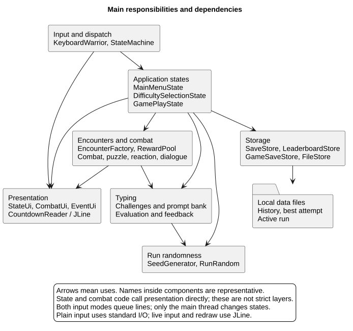

[Editable PlantUML source](diagrams/architecture-overview.puml).

Typing evaluation measures performance without reading the terminal or applying damage. `combat` contains
participants, skills and damage rules; `encounter` manages combat, puzzles, reactions and dialogue. `storage` persists local files,
while `seed` supplies reproducible random choices. The following diagrams expand these boundaries
only where their internal structure or interaction matters.

### Runtime and terminal input

With a capable terminal, JLine and `CountdownReader` preserve edited input while displaying the
countdown. The background thread supplies complete lines through a queue; only the main thread
dispatches commands and updates the active state. Each main-loop iteration processes queued input,
calls `update()` and sleeps for 100 milliseconds. The sequence diagram omits prompt rendering and
shutdown handling to make that thread boundary visible.

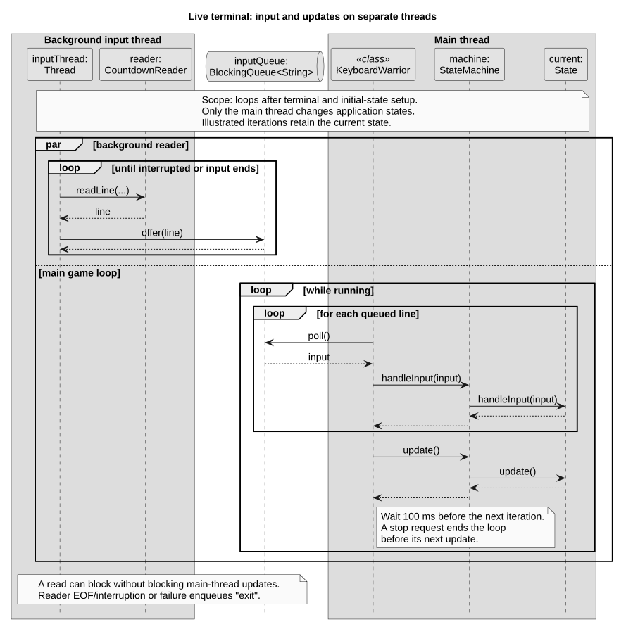

[Editable PlantUML source](diagrams/runtime-input.puml).

If there is no native console or JLine cannot redraw it, plain mode uses a background buffered reader.
It queues each complete line, followed by EOF or a reader failure; the main thread polls every 100 ms,
dispatches lines and calls `updateWaiting()`. This lets a reaction command appear without Enter.
It does not call the full `update()`, because a buffered console cannot reliably deliver unfinished
text. Enter submits the answer using actual elapsed time: late combat still deals calculated damage,
whereas late event responses fail their deadline. Both modes stop cleanly on `exit` or end-of-input.

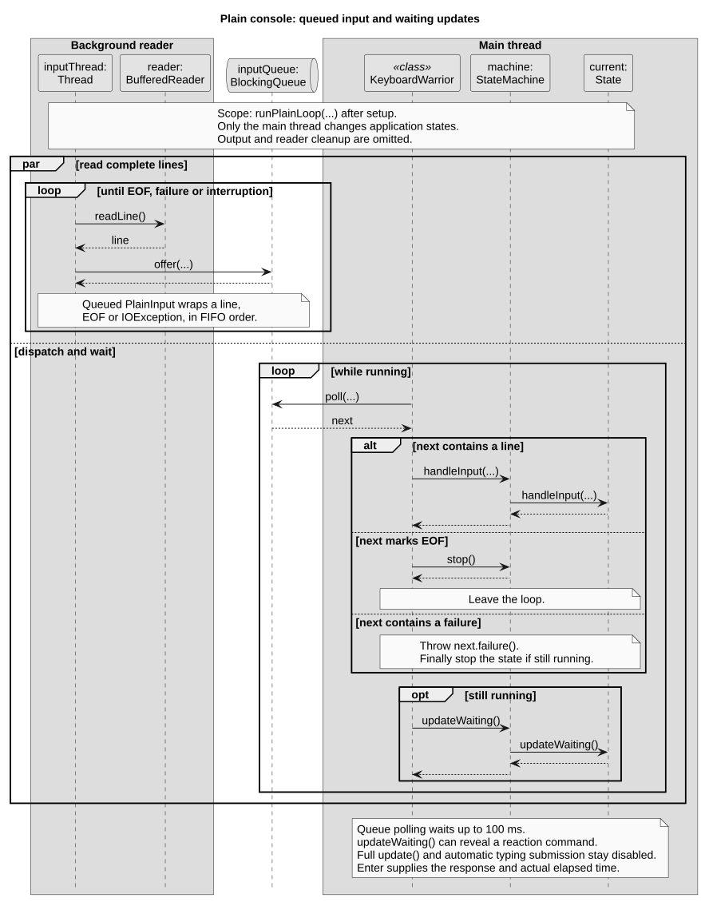

[Editable PlantUML source](diagrams/plain-input.puml).

### State management

The state machine retains one current `State` and delegates `handleInput(...)`, `update()` and
the safe plain-mode `updateWaiting()` hook to it. `transitState(...)` exits the old state before entering its replacement. Concrete states keep their
own interaction rules; the menu's pending seed input is a flag, not a separate state class.

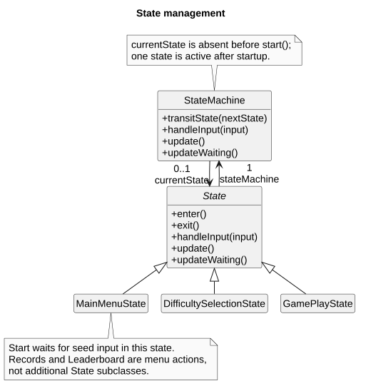

[Editable PlantUML source](diagrams/state-structure.puml).

Start accepts a seed before entering gameplay; Choose Difficulty returns to the menu with the
selected mode; Continue restores a saved run. Victory and defeat return to the menu. Records and
Leaderboard display results inside the existing menu and do not trigger a state transition.

### Single Level of Abstraction Principle (SLAP)

The larger coordinating methods delegate detailed work to private helpers. This keeps the sequence
of actions readable while placing parsing, validation, storage and effect calculations in named
operations. The helpers remain in the classes that own the relevant state.

| Class | Coordination and helper responsibilities |
| --- | --- |
| `GamePlayState` | `finishAttempt(...)` checks the deadline, then calls `evaluateAttempt(...)`, `saveTypingHistory(...)`, `resolveAttempt(...)` and `advanceAfterAttempt()`. `finishRun()` handles save deletion and return to the menu. |
| `MainMenuState` | `handleInput(...)` dispatches commands to `requestSeed()`, `startSeededRun(...)`, `showRecords()`, `showLeaderboard()` and `continueSavedRun()`. Each loading action handles its own storage errors. |
| `DialogueEncounter` | `submitAnswer(...)` controls the lifecycle and branch selection; `resolveTrade(...)`, `grantTradeReward()` and `resolveEscape(...)` apply the branch-specific effects and feedback. |
| `GameSave` | Its constructor copies collections and calls `validateRunProgress(...)`, `validateSkills(...)`, `validateEncounterSelection(...)` and `validateCombatFields(...)` before accepting the snapshot. |
| `GameSaveStore` | `save(...)` converts the snapshot through `toProperties(...)`, then calls `writeProperties(...)`. Separate encoding helpers populate progression, encounters and optional random history. |
| `EncounterFactory` | `restore(...)` dispatches to `restoreCombat(...)`, `restorePuzzle(...)`, `restoreReaction(...)` or `restoreDialogue(...)`; `restoreCombatEnemy(...)` checks opponent bounds and restores HP. |

Ordering remains part of the contract. Typing feedback is displayed and history saving is attempted
before encounter resolution; a history `IOException` does not prevent that resolution. Dialogue
enters `RESOLVING` before terminal rewards or penalties, preventing repeated effects on retries.
Snapshot validation still runs during construction, and restoration preserves random-call order.

Private helpers are sufficient for this decomposition. The existing abstract classes continue to
share state and behavior; the refactor introduces no new interfaces or public APIs. Commands,
scoring, checkpoints and save-file formats are unchanged. See [automated checks](#automated-checks)
for the behavior-level regression tests used to verify these boundaries.

## Implementation

### Source launchers and release startup

`run-game.bat` and `run-game.sh` first invoke Gradle's `prepareTerminalRun` task. That task depends on
`classes`, writes the runtime classpath and the build JVM's Java home, and does not create a JAR.
The launcher starts Java in the foreground with `-ea` and native access enabled. Direct terminal
input avoids Gradle `run` and IDE Run console stream redirection, which can prevent JLine from seeing
unsubmitted keystrokes. On Windows, the entry point selects the native Windows terminal type even
when the launcher supplies `TERM=dumb`.

These scripts are conveniences for a source checkout. The release is one executable fat JAR for
Windows, macOS and Linux and must start with Java 25 using `java -jar KeyboardWarrior.jar` without
Gradle or repository scripts. Its manifest includes `Enable-Native-Access: ALL-UNNAMED` for JLine's
bundled native support; this removes Java 25's native-access warning but does not create a terminal.

### Game difficulty selection

`GameDifficulty` is separate from `TypingChallenge.Difficulty`: it describes run modifiers rather
than passage content. Easy, Normal, Hard and Coder use multipliers 4, 2, 1 and 0.8 for player damage,
starting health and countdowns. Hard is the default to preserve the original balance.

`MainMenuState` accepts numbers 1-6 or the names Start, Records, Exit, Choose Difficulty, Continue and Leaderboard.
`DifficultySelectionState` accepts a mode number or name, then returns to a new menu with the same
`SaveStore` and selected mode. Invalid input leaves the selection menu active. Gameplay passes that
mode back to the menu after victory or defeat, preserving it for the session. The menu selection is
not saved separately, but the active run save includes its mode. Continue restores that mode.

`GamePlayState` creates the player with 400, 200, 100 or 80 HP and supplies the mode to the shared
`TypingChallengeFactory` and every `CombatEncounter`, including both boss phases. The factory applies
the countdown multiplier after calculating the normal base deadline and rounds up. Encryption uses
a base of 60 seconds before earned countdown adjustments, becoming 240, 120, 60 or 48 seconds
with no adjustment. `SkillResolver` multiplies typing damage before rounding down once. Automated enemy attacks keep their original base damage.

### Seeds and reproducible choices

After Start, `MainMenuState` treats the next line as a seed rather than a menu choice.
`SeedGenerator.parseSeed(...)` trims a nonblank line, parses it as a signed Java `long`, or uses
the trimmed string's `hashCode()` if numeric parsing fails. Blank input generates a fresh random
`long`. Text seeds are case-sensitive, and an out-of-range integer is handled as text. The resolved
numeric seed is displayed. At this prompt `exit` quits; `3` is a seed, not the menu's Exit shortcut.

One `RunRandom` supplies offered enemies, event categories and content, reaction delays, rewards
and typing prompts, including Encryption. It follows Java `Random`'s
48-bit sequence. `snapshot()` stores its position and `restore(...)` resumes without replaying draws.
`PromptBank` separately remembers the previous passage at each difficulty to avoid immediate repeats.

The object diagram is an illustrative snapshot while choosing a skill, not an additional class
structure. The gameplay state and encounter reference the same player and challenge factory; the
bank and state share the generator. Replacing an encounter preserves these run-wide objects.

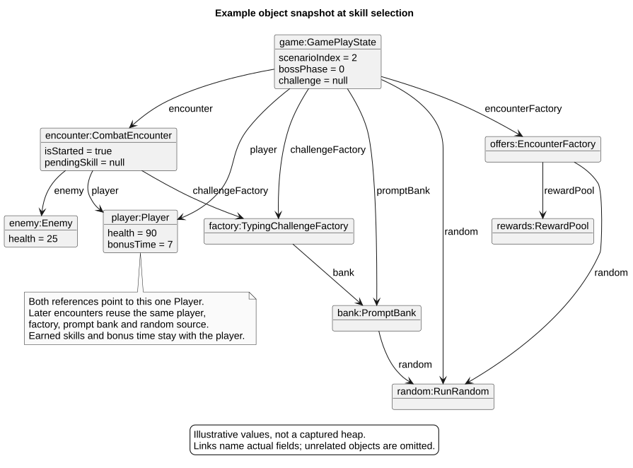

[Editable PlantUML source](diagrams/active-run-objects.puml).

Repeating the same seed, encounter choices, event outcomes and skill sequence reproduces random
choices in the same product version. All three offers are generated before selection and consume
randomness even when not selected. Reward draws occur only when earned, and an empty pool draws
nothing. Different routes or turn counts therefore change later choices; typing performance is not fixed.

### Records and all-time leaderboard

#### Responsibilities and stored data

`SaveStore` retains the latest ten attempts, oldest first; its `LeaderboardStore` retains one best
attempt after history rotation. Each immutable `SavedRecord` contains WPM and character accuracy,
without a difficulty, seed, timestamp or player identifier. All runs using the same files share
these views; row numbers are display positions. Partial and zero-score attempts are eligible.

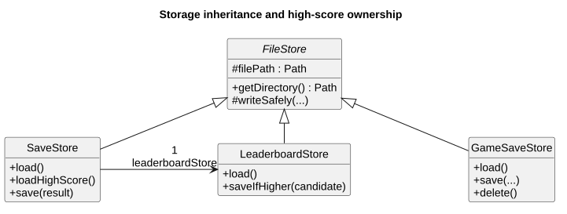

[Editable PlantUML source](diagrams/storage-structure.puml).

All three stores inherit safe replacement from `FileStore`. The menu and gameplay reuse the same
history store. Gameplay retains its run store; the menu creates one locally when Continue is chosen.
An injected history path also determines the sibling high-score path and the run-save directory.
Default files are relative to the launch directory:

| File | Contents | Retention |
| --- | --- | --- |
| `data/keyboardwarrior.txt` | UTF-8 lines in `wpm,accuracyPercent` format | Latest ten attempts, oldest first |
| `data/keyboardwarrior.txt.high-score` | Exactly one UTF-8 line in the same format | Best attempt until a better one is saved |

For example, a custom history path `test-data/history.txt` uses `test-data/history.txt.high-score`.
Neither file contains resumable game state; that belongs to `GameSaveStore`.

#### Saving attempts and preserving the best score

The sequence follows one evaluated response through history saving and encounter resolution. The nested
`loadHighScore()` call initializes the best available history entry before rotation if an
installation has no high-score file yet. File-format details are outside this store-level sequence.
The storage sequences omit private orchestration helpers: `finishAttempt(...)` reaches history
through `saveTypingHistory(...)`, then dispatches the response through `resolveAttempt(...)`.

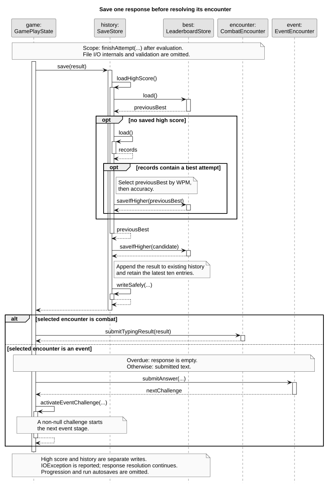

[Editable PlantUML source](diagrams/history-saving.puml).

The sequence below shows the successful save path, including first-use initialization from existing
history. Preserving that best record before trimming the history prevents it from being lost when
the oldest entry is removed. `candidate` is the WPM/accuracy pair from the new `TypingResult`, and
`existingBest` is the highest-ranked record in the loaded history. File operations and the internals
of `saveIfHigher(...)` are summarized to keep the ordering clear.

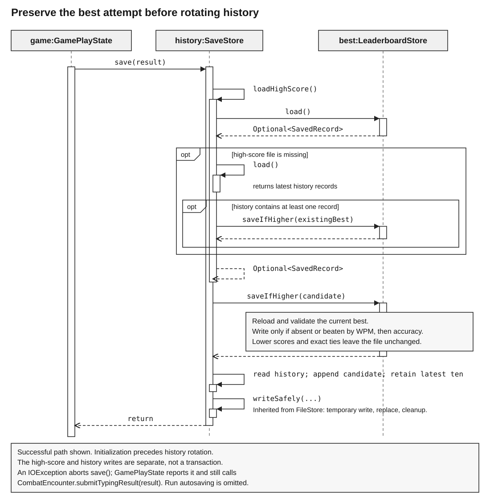

[Editable PlantUML source](diagrams/typing-history-save.puml).

`LeaderboardStore.SCORE_ORDER` compares full-precision WPM first, then accuracy. Higher WPM wins
regardless of accuracy; higher accuracy wins when WPM is equal. Lower scores and exact ties leave
the high-score file untouched. For example, after `60,95`, an attempt of `50,100` cannot replace it,
`60,98` can, and `70,80` then becomes the best. The UI rounds values to two decimal places only for display.

`loadHighScore()` returns `Optional<SavedRecord>` and initializes from available history only when
the high-score file is absent. Attempts already discarded cannot be recovered. Once the high-score
file exists, reading it does not depend on history.

Both stores use `FileStore.writeSafely(...)`: write a complete temporary file in the destination
directory, then replace the destination with an atomic move where supported, or a regular replacement
move otherwise. Temporary files are cleaned up in `finally`. These are separate file writes, not a
transaction across both files. If updating the high score fails, history is not appended; if history
writing fails after the high score succeeds, the new best can remain saved without its history entry.
The gameplay state reports the `IOException` as a typing-history saving error and still resolves the response.

#### Menu display and error handling

`MainMenuState` trims commands and accepts option names case-insensitively:

| Command | Load and display flow |
| --- | --- |
| `2` or `records` | `showRecords()` loads an immutable list through `SaveStore.load()` and passes it to `StateUi.showRecords(...)` |
| `6` or `leaderboard` | `showLeaderboard()` loads through `SaveStore.loadHighScore()` and selects `StateUi.showLeaderboard(SavedRecord)` or `StateUi.showEmptyLeaderboard()` through `ifPresentOrElse(...)` |

After results, an empty message or a loading error, `showMainMenu(difficulty)` redisplays all options
without changing state or difficulty. The state unwraps optional records before passing them to the
UI. `StateUi` routes output through the attached terminal or standard output in either input mode.

A missing history file produces an empty list. A missing high-score file triggers initialization;
if there is also no history, the leaderboard shows its empty message. Loaded WPM must be finite and
nonnegative, and accuracy must be finite and within 0-100. Each record needs exactly two fields, and
the high-score file must contain exactly one line. Malformed loaded data and unreadable files produce
`IOException`; an invalid high-score file is not silently overwritten or replaced from history.
`SavedRecord` itself has no validating constructor. `SaveStore.load()` validates the latest ten
history lines it returns, while `LeaderboardStore` validates loaded scores and candidates passed to
`saveIfHigher(...)`. Earlier lines in an oversized history file are ignored by `load()`.
Records reports `Could not load typing history: ...`; Leaderboard reports `Could not load leaderboard: ...`.

#### Design choices and alternatives

| Choice | Rationale | Alternative considered |
| --- | --- | --- |
| Separate persistent high score | Keeps the best attempt after history rotation and application restarts | Computing a maximum from the latest ten loses older best attempts; an in-memory maximum is lost on restart |
| Two numeric fields per record | Reuses existing typing metrics and a simple local file format | Keeping every attempt would allow broader statistics but requires unbounded history or a retention policy |
| Redisplay the existing menu | Preserves difficulty and storage without extra navigation state | A dedicated state would be useful if these views later gained interactive filtering or pagination |

### Active run saves

`GameSave` version 2 captures either three pending encounter choices or one selected, unfinished
encounter. It also stores difficulty, player HP, signed `bonusTime`, ordered owned skill IDs,
zero-based `scenarioIndex`, `bossPhase` and an optional `RandomSnapshot`. Regular indices are 0-4
with phase 0; boss index 5 permits phase 1 or 2 and combat only. Positive HP above starting health
is valid because event rewards can heal the player. Dead or completed encounters cannot be saved.

`EncounterSnapshot` is an immutable type tag and validated string map. It retains already generated
content rather than requesting a new random encounter on Continue:

| Snapshot type | Data fields |
| --- | --- |
| `combat` | `enemyType`, `enemyHealth`, `nextEnemySkillIndex` |
| `puzzle` | `phase`, selected `question` and `answer` |
| `reaction` | `phase`, `targetWord`, remaining `delayMillis` |
| `dialogue` | `phase`, `node` (0 opening, 1 trade, 2 escape) |

`NOT_STARTED` identifies an offered event. An unstarted selected event can also be loaded safely;
the controller prepares its first stage. Prepared active events can be `WAITING` (reaction only) or
`ACCEPTING_ANSWER`. `RESOLVING` and `COMPLETED` are rejected. `GameSave` checks the three-choice shape,
event phases, registered unique skills including the starting loadout, and combat HP/rotation against
the saved scenario. `CombatEncounter.snapshot()` remains restricted to started, stable turns;
`snapshotForSave()` additionally supports an unselected combat offer. Neither allows a pending attack.

`GameSaveStore` stores UTF-8 Java properties at `data/game-save.properties`, separately from history
and the leaderboard. An alternate history directory also determines this path. It inherits
temporary-file replacement from `FileStore`. Invalid fields or unsupported versions produce
`IOException`; a missing file means no saved run. Continue validates before leaving the menu.

| Property or prefix | Stored value |
| --- | --- |
| `version`, `difficulty`, `playerHealth` | Version `2`, mode enum name and positive remaining HP |
| `scenarioIndex`, `bossPhase` | Regular scenario 0-4/phase 0 or scenario 5/boss phase 1-2 |
| `bonusTime`, `skillIds` | Signed countdown adjustment and comma-separated owned registry IDs in display order |
| `choiceCount` | `3` for pending choices; `0` for one active encounter |
| `choice.<index>.type` and sibling fields | Each zero-based offered snapshot's type and data |
| `activeEncounter.type` and sibling fields | Selected snapshot's type and data; absent while choosing |
| `randomState`, `previousPrompt.<DIFFICULTY>` | Unsigned 48-bit generator position and per-difficulty previous passage indices |

Version-1 combat saves migrate to the current in-memory representation with the five starting
skills and zero bonus time. Their top-level enemy fields retain HP and rotation. Optional random
fields are preserved if present; missing random data cannot recover the original future choices.
A previous-prompt key without `randomState`, invalid passage index or invalid generator position
is rejected. New files use prefixed encounter fields and do not write the legacy opponent fields.

The gameplay constructor restores `RunRandom` and prompt history before `restoreRun()` is entered.
`restoreRun()` calls `restoreRunProgress()`, `showRestoredProgress()` and `restorePendingEncounter()`
in order. The first helper rebuilds the player without replaying rewards or reapplying difficulty
scaling, then creates one shared `EncounterFactory`. Its `RewardPool` excludes the restored owned
skills, so an earned Overclock is not offered again.

Pending choices are reconstructed directly; a selected encounter is reopened through
`resumeActiveEncounter(...)`. Rebuilding the saved content consumes no random draws. For autosaving,
`createRunSnapshot()` checks stable-state assertions and captures the data before `saveCurrentRun()`
passes it to storage and reports any write failure.

Runtime clocks, terminal objects and unfinished input are excluded. An interrupted combat returns
to skill selection with the saved pre-challenge random position; choosing the same skill reproduces
its passage. An event resumes its question, reaction command or dialogue branch with a fresh response
deadline. A waiting reaction resumes its saved remaining delay relative to the new clock, without
rerolling the delay. Explicit Exit during that wait updates its remaining-delay checkpoint.

Autosaves occur after offers, encounter selection, a revealed reaction prompt, a dialogue follow-up,
a surviving combat turn and scenario/boss transitions. No manual save command is exposed. Start
replaces the old slot when its first choices are ready; run victory or defeat deletes it; Exit retains
it. Save IO failures are reported while gameplay remains usable. Assertions check living players and
valid progression; file validation uses exceptions even when assertions are disabled.

### Typing evaluation and damage

#### Responsibilities and data flow

The typing package evaluates a completed input snapshot. It does not read the terminal, measure time,
apply damage or select an enemy. `GamePlayState` supplies expected text, current input, elapsed seconds
and required seconds to `TypingEvaluator.evaluateTyping(...)`. The returned `TypingResult` is immutable.
The state prints and saves a summary. Combat receives the same result through
`CombatEncounter.submitTypingResult(...)` and delegates damage to `SkillResolver`. Events instead
receive their submitted response through `submitAnswer(...)`; an overdue event receives an empty
response so a late matching answer cannot earn its reward.

| Class | Responsibility |
| --- | --- |
| `TypingEvaluator` | Validate and normalize the four inputs; coordinate metrics and retained word diagnostics |
| `AccuracyCalculator` | Compute character accuracy using Levenshtein edit distance |
| `WpmCalculator` | Compute gross WPM from normalized submitted character count and elapsed seconds |
| `WordErrorFinder` | Retain positional wrong, missing and extra word diagnostics for later features |
| `TypingResult` | Store full-precision metrics, supplied times and a defensive copy of word errors |
| `TypingResultFormatter` | Produce the short gameplay summary or optional detailed word report |
| `SkillResolver` | Convert typing performance into damage and earned skill time bonuses; apply HP changes |
| `TypingChallengeFactory` | Create skill or custom event challenges and scale deadlines by run difficulty |

The sequence follows the evaluator's collaborator calls after validation and normalization: retained
word diagnostics, gross WPM, character accuracy, then result construction. `<<class>>` participants
receive static calls; `result:TypingResult` is the newly created object. The caller, terminal,
formatting and combat are outside this diagram's scope. Edit-distance internals are explained below
rather than expanded into the same sequence.

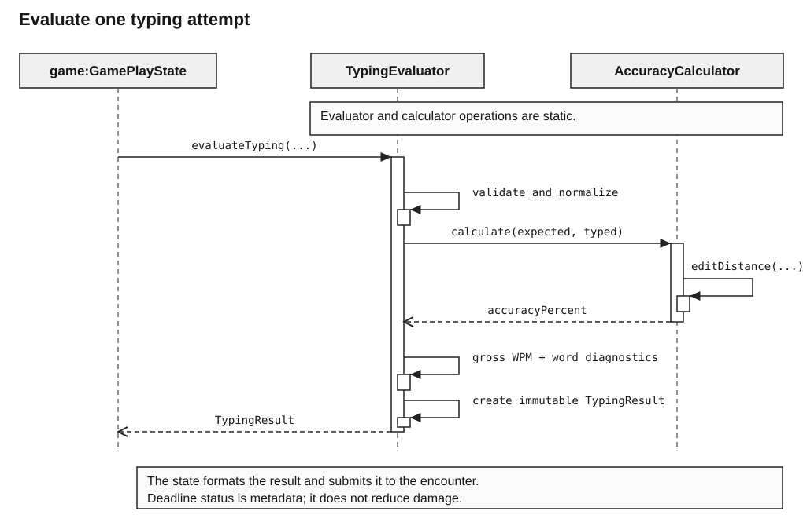

[Editable PlantUML source](diagrams/typing-evaluation.puml).

#### Normalization and character accuracy

Both strings are normalized with `trim()` and `replaceAll("\\s+", " ")`. This removes leading and
trailing whitespace and collapses repeated internal whitespace. Capitalization and punctuation are
preserved. Let `expected` and `typed` denote those normalized strings.

```text
accuracyPercent = 100 * (1 - editDistance(expected, typed) / max(expectedLength, typedLength))
```

Edit distance is the minimum number of insertions, deletions and substitutions that transforms one
string into the other. `AccuracyCalculator` compares Unicode code points, so a supplementary character
counts as one character for accuracy. A deleted character is one edit rather than a shift that makes
every later character incorrect. Empty typed text is valid and produces zero accuracy; expected text
must remain nonempty after normalization, guaranteeing a positive denominator.

The implementation uses the usual dynamic programming recurrence. Each cell takes the minimum of
insertion, deletion and substitution cost. Only the previous and current row are retained, and the
shorter string occupies the columns. Runtime is `O(m * n)` and working memory is `O(min(m, n))` for
code point counts `m` and `n`. English challenge passages keep these inputs small. Evaluation compares
final text snapshots, so it cannot count mistakes that the player corrected before submission.

Word diagnostics remain separate from accuracy. `WordErrorFinder` still compares words at corresponding
positions and produces `WRONG`, `MISSING` and `EXTRA` entries. These entries are preserved for future
feedback; their count does not determine character accuracy. Gameplay uses `formatTypingSummary`,
which prints WPM, accuracy and the two times without the word list. `formatTypingResult` remains
available for detailed component inspection.

#### Speed, damage and time allowance

Gross WPM remains `(normalizedTyped.length() / 5.0) / (elapsedSeconds / 60.0)`. The existing WPM contract
uses Java `String.length()` (UTF-16 code units), whereas character accuracy uses code points. This
produces the same length for the intended ASCII English passages. Incorrect submitted characters and
normalized spaces count toward gross speed; Enter and discarded surrounding whitespace do not.

Player damage is now independent of the chosen skill's base damage:

```text
accuracyFraction = accuracyPercent / 100
playerDamage = floor(wpm * accuracyFraction^4 * gameDifficultyMultiplier)
```

`SkillResolver` calculates with full precision and rounds down once. On Hard, at 50 WPM and 95% accuracy this
is `floor(50 * 0.95^4) = 40`; at 50 WPM and 80% accuracy it is 20. The fourth power rewards accurate
input and limits the benefit of entering fast, unrelated text. A skill still chooses passage
difficulty. Its base damage continues to apply when the resolver receives no typing result for an
automated enemy attack. This preserves existing enemy skill rotations.

The countdown limits how long an attempt can remain open. For skills other than Encryption,
`TypingChallengeFactory` computes:

```text
minimumSeconds = 15 / 30 / 30 / 45 for Easy / Medium / Hard / Ultimate
baselineSeconds = normalizedPrompt.length() * 60 / (5 * 50)
baseSeconds = max(minimumSeconds, ceil(baselineSeconds * 1.2))
adjustedSeconds = max(10, min(Integer.MAX_VALUE, baseSeconds + playerBonusTime))
finalSeconds = ceil(adjustedSeconds * gameDifficultyMultiplier)
```

This gives a 50 WPM player a 20% time buffer while retaining the previous minimum allowances.
The buffer increases available typing time; it is not a damage multiplier. Required time therefore
varies by passage. `ChallengeClock` starts after prompt display. Skill selection and previous turn
feedback are outside the measured duration.

`CombatEncounter` calls `TypingChallengeFactory.generateForSkill(...)` so skills sharing a difficulty
can use different passages. Encryption remains Ultimate, with a base deadline of exactly 60 seconds
before adding the player's bonus, enforcing the ten-second minimum and applying the mode multiplier.
`PromptBank.getEncryptionPrompt()` uses a randomly selected Ultimate passage's character count as
its target length, then generates random special characters in space-separated groups of one to six.
The resulting passage is between the target length and six characters longer. Other skills continue
to use the difficulty-based generator above.

Overclock is an earnable Easy skill with base time bonus 20. It deals the same performance-based
damage as other player skills and also adds `floor(20 * unroundedDamage / 50)` seconds to
`Player.bonusTime`. For example, 50 WPM and 100% accuracy on Hard grants 20 seconds. Zero damage
earns no bonus. The adjustment affects subsequent skill challenges before difficulty scaling;
accumulated adjustments saturate at integer limits rather than overflowing. Puzzle and dialogue
penalties reduce that same persistent adjustment. Event-specific countdown rules are described below.

Both Enter and live-terminal automatic expiry use the same evaluator. At expiry, `GamePlayState.update()` obtains
`StateUi.takeCurrentInput()` before clearing the editable line and resolving the attempt. The actual
elapsed duration is supplied, so captured partial text retains its measured WPM and accuracy.
`isTimeLimitExceeded()` reports the strict comparison `elapsedSeconds > requiredSeconds`. It is
metadata for combat: overdue attacks receive no additional damage reduction. The retained compatibility getter
`getTimeDamageMultiplier()` returns `1.0`; player damage does not depend on it.
Plain mode calls only the safe waiting-update hook; `handleInput(...)` evaluates a line when Enter
arrives. Event matching remains deadline-sensitive in both modes: an overdue response is treated as
incorrect, even though its actual typed text still supplies the displayed and saved metrics.

#### ChallengeClock implementation

[`ChallengeClock`](https://github.com/AY2627S1-CS2113-W12-4/tp/blob/master/src/main/java/seedu/keyboardwarrior/typing/ChallengeClock.java) measures time;
it does not create a thread, sleep, print a countdown or submit an answer. The active state reads
the clock and decides what to display or resolve. The [runtime diagrams](#runtime-and-terminal-input)
show how state updates continue while the input reader waits for typing.

The clock stores `startTimeNanos` and `durationNanos` as `long` values. `start(int durationSeconds)`
converts seconds to nanoseconds using `1_000_000_000L` and records `System.nanoTime()`.
This measures elapsed time independently of wall-clock adjustments. The absolute `nanoTime()` value
has no calendar meaning and may be negative; only the difference between readings is used.

| Method | Behavior |
| --- | --- |
| `start(durationSeconds)` | Starts or restarts the countdown by replacing both stored values. Zero expires immediately. A negative argument throws `IllegalArgumentException` before changing the existing timer. |
| `getRemainingSeconds()` | Returns zero before starting or after a zero-duration start. Otherwise, subtracts elapsed nanoseconds from the duration, clamps the remainder to zero and rounds any partial second up. It continues returning zero after expiry. |
| `getElapsedSeconds()` | Returns fractional seconds since the most recent positive-duration start. Returns `0.0` before starting or after a zero-duration start. Unlike remaining time, elapsed time continues increasing after expiry so late submissions retain their actual measured duration. |

For a positive-duration timer, the remaining-time calculation is:

```text
elapsedNanos = System.nanoTime() - startTimeNanos
remainingNanos = max(0, durationNanos - elapsedNanos)
remainingSeconds = (remainingNanos + 1_000_000_000 - 1) / 1_000_000_000
```

The final division is integer division. For example, a ten-second timer with 8.2 seconds elapsed
reports **2 seconds remaining**, while `getElapsedSeconds()` reports approximately **8.2**.
At or beyond ten seconds it reports **0 remaining**. Use the fractional elapsed getter for WPM;
subtracting the rounded remaining seconds from the duration would lose timing precision.

Both getters assert that the stored duration and the measured elapsed difference are nonnegative.
These assertions detect internal invariant violations when enabled with `-ea`; they do not require
the absolute start timestamp to be positive. The negative-duration exception remains active even
with assertions disabled. See [clock unit tests](#challengeclock-unit-tests) for current coverage.

#### Validation and defensive checks

Null text or dependency references cause `NullPointerException`. Blank normalized expected text,
nonpositive or nonfinite times and out-of-range result metrics cause `IllegalArgumentException`.
Empty player text is a valid zero-score attempt. Result fields are immutable; word error lists are
copied and exposed as unmodifiable lists. `WordError` positions begin at 1 and use an empty string
for an absent word.

Assertions check computed accuracy bounds, finite nonnegative WPM, edit distance bounds and health
updates. Public argument checks remain active without `-ea`. The state clears its active challenge
before completing a turn, and the encounter requires exactly one pending skill before accepting a
result. A duplicate result or invalid turn sequence causes `IllegalStateException`, preventing
accidental double attacks. Existing `FINE` logging records combat events without cluttering gameplay.

#### Design choices and alternatives

| Choice | Rationale | Alternative considered |
| --- | --- | --- |
| Character edit distance | Local insertions and deletions produce local accuracy costs | Positional word matching can mark the rest of a passage wrong after one omitted word |
| Two-row dynamic programming | Retains the exact score with bounded working memory | A full matrix stores every cell and is only useful if a later feature needs an edit trace |
| Fourth-power accuracy factor | Makes careful typing matter while keeping one formula across skills | Linear accuracy penalizes fast inaccurate text less; skill base multipliers make equal typing performance deal different damage |
| Length-based deadline with a minimum | Makes longer passages achievable at the balance target | One fixed deadline per skill can demand very different WPM from randomly selected passages |
| Combat deadline as metadata | Capture ends the turn without a second damage reduction | An extra late multiplier obscures the relationship between text, speed and damage |

### Combat model and encounter lifecycle

The combat package defines mutable participants and shared skill definitions. `Encounter` supplies
display text, completion state and guarded outcome access. `CombatEncounter` handles combat turns;
the `EventEncounter` subclasses handle the noncombat choices described in the next section.

The class diagram shows how `Player` and `Enemy` inherit their active-skill collection from
`Entity`. The registry, loadouts and reward pool reference shared `Skill` objects. The dashed arrow
shows the pool's registry lookup. `RewardPool` also inspects the player's skills at construction,
but does not retain the player. Removing a reward changes only the pool's list; the event caller grants it.

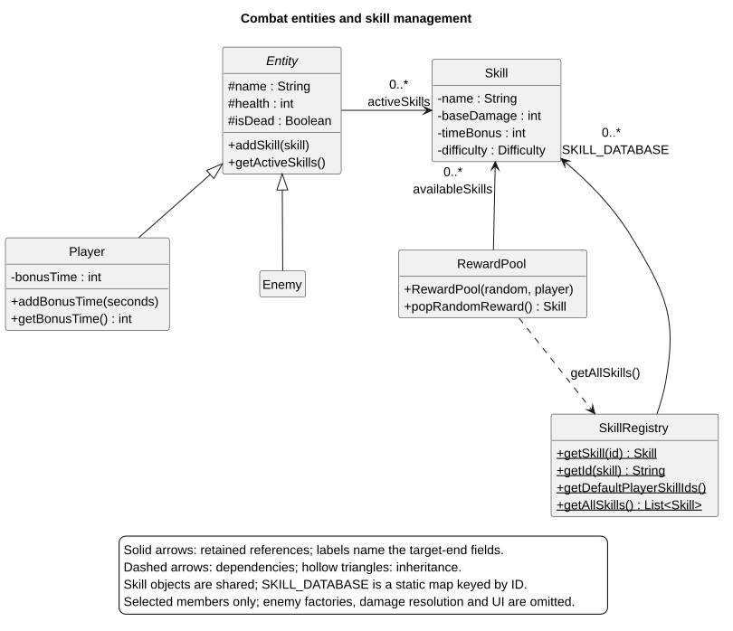

[Editable PlantUML source](diagrams/combat-skills.puml).

| Class | Responsibility |
| --- | --- |
| `combat.Entity` | Store a participant's display name, nonnegative HP, defeated flag and active skills |
| `combat.Player` | Hold the starting/earned loadout and cumulative signed bonus time |
| `combat.Enemy` | Represent an opponent whose loadout is supplied by a factory |
| `combat.Skill` | Store a skill's display name, base damage, base time bonus and typing difficulty |
| `combat.SkillRegistry` | Own the shared skill definitions and resolve stable skill identifiers |
| `combat.EnemyFactory` | Build registered enemies, scenario-scaled opponents and both boss phases |
| `combat.SkillResolver` | Calculate typed player damage or use base damage for automated enemy attacks, then clamp HP at zero |
| `encounter.Encounter` | Define display text, completion state and guarded outcome access |
| `encounter.EncounterOutcome` | Store the final victory flag; it defaults to `false` until completion |
| `encounter.CombatEncounter` | Enforce turn order, generate player challenges, rotate enemy attacks and finalize victory or defeat |

`Entity` rejects null or blank names and negative HP. Skills cannot be null, and `Skill` similarly
rejects blank names, negative base damage and null typing difficulties. The active-skill collection
is ordered: the player receives Ping, Brute Force, Buffer Overflow, SIGKILL and Encryption. Registry
lookups use the lowercase identifiers below and reject an unknown identifier.

| Identifier | Display name | Base damage | Base time bonus | Typing difficulty |
| --- | --- | --- | --- | --- |
| `ping` | Ping | 10 | 0 | Easy |
| `brute_force` | Brute Force | 20 | 0 | Medium |
| `buffer_overflow` | Buffer Overflow | 40 | 0 | Hard |
| `sigkill` | SIGKILL | 80 | 0 | Ultimate |
| `encryption` | Encryption | 80 | 0 | Ultimate |
| `overclock` | Overclock (earned) | 0 | 20 | Easy |

Base damage is used when `SkillResolver.execute(...)` receives a null `TypingResult`, which is the
automated enemy-turn path. A player turn supplies a result and instead uses the WPM/accuracy formula
described in the Typing evaluation and damage section. Consequently, selecting a higher-base-damage player skill does not
directly increase player damage; it selects a different typing challenge.

`EnemyFactory.createEnemy(type)` provides the registered identity and attack rotation. Its default HP
is useful for direct construction, while `createScenarioEnemy(...)` and
`createRandomEnemy(random, scenarioNumber)` replace it with the current scenario's 30/35/50/60/70 HP.
Enemy identifiers are normalized with `Locale.ROOT`, keeping lookup independent of the host locale.

| Type identifier | Display name | Default HP | Repeating attack rotation |
| --- | --- | ---: | --- |
| `rogue_ai` | Script Kiddie | 80 | Ping, Brute Force, Buffer Overflow |
| `malware_bot` | Malware Bot | 120 | Ping, Brute Force |
| `firewall_golem` | Firewall Golem | 90 | Ping, Buffer Overflow |
| `cache_goblin` | Cache Goblin | 80 | Ping, Brute Force |
| `phantom_packet` | Phantom Packet | 90 | Ping, Buffer Overflow |
| `cipher_serpent` | Cipher Serpent | 100 | Brute Force, Buffer Overflow |
| `trojan_knight` | Trojan Knight | 110 | Ping, Brute Force |
| `null_dragon` | Null Dragon | 120 | Brute Force, Buffer Overflow |

Boss creation is separate: phase 1 has 50 HP and repeatedly uses Ping for 10 damage, while phase 2
has 70 HP and repeatedly uses Brute Force for 20 damage. `getTypeId(...)` converts configured regular
enemies back to their stable identifiers and maps either boss phase to `kernel_overlord` for saving.

A `CombatEncounter` can run synchronously through `start()`, or the state machine can use its split
API so countdown updates remain nonblocking:

1. `begin()` announces combat and opens the first player turn. `begin(savedIndex)` restores the next
   enemy attack without taking an extra turn.
2. `preparePlayerTurn(skill)` verifies that combat is active and the player owns the skill, generates
   one challenge, and records exactly one pending skill.
3. `submitTypingResult(result)` resolves that skill. A lethal player attack completes victory before
   retaliation; otherwise the enemy uses its next base-damage skill and advances its index modulo the
   loadout size.
4. A lethal enemy attack completes defeat. If both participants remain alive, the encounter displays
   the next player turn.

Only one result can resolve each prepared turn. Calls made before `begin()`, after completion or while
another skill is pending fail with `IllegalStateException`. `Encounter.getEncounterOutcome()` is also
unavailable before completion. On completion, combat marks the defeated entity, sets the outcome and
sets `isCompleted`; gameplay advances only after reading a completed victorious outcome.

`CombatEncounter.snapshot()` is deliberately narrower than the encounter itself. Between stable
turns it returns the enemy type, remaining HP and next attack index. It rejects snapshots before
combat starts, while a typing result is pending or after combat completes, preventing a save from
representing a partially resolved turn.

### Encounter choices and events

The hierarchy separates combat turns from the common event lifecycle. Hollow triangle arrows
point from each subclass to its superclass: both `CombatEncounter` and abstract `EventEncounter`
extend `Encounter`, while puzzles, reactions and dialogue extend `EventEncounter`.

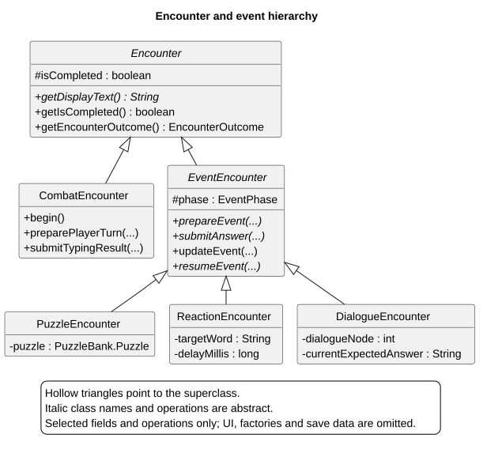

[Editable PlantUML source](diagrams/encounter-hierarchy.puml).

The diagram shows selected fields and operations. `EncounterFactory` obtains content from
`PuzzleBank` and `ReactionBank` before constructing events; `PuzzleEncounter` retains a
`PuzzleBank.Puzzle` value and `ReactionEncounter` retains a target string, rather than either
encounter retaining its content bank.

`startScenario()` asks the run's shared `EncounterFactory` for three unstarted choices: combat,
one event, then an equal-probability combat or event. Event categories (puzzle, reaction and dialogue)
are sampled uniformly. The production factory overload receives scenario number and difficulty,
so offered combats retain 30/35/50/60/70 HP and the selected damage multiplier. Its older overload
keeps default enemy HP and Hard damage for standalone component callers.

`chooseEncounter(...)` accepts 1-3, selects an already generated object and clears the offers.
Invalid input leaves both choices and randomness unchanged. A combat begins at skill selection;
an event calls `prepareEvent(...)`. The controller displays and times each returned challenge,
but `StateUi.showEventChallenge(...)` replaces a puzzle's hidden answer with response instructions.
`updateWaiting()` polls reaction delays. Within `finishAttempt(...)`, `saveTypingHistory(...)` saves
metrics before `resolveAttempt(...)` calls `submitAnswer(...)` and activates any dialogue follow-up.
`advanceAfterAttempt()` saves an unfinished encounter or advances after a completed survival outcome.

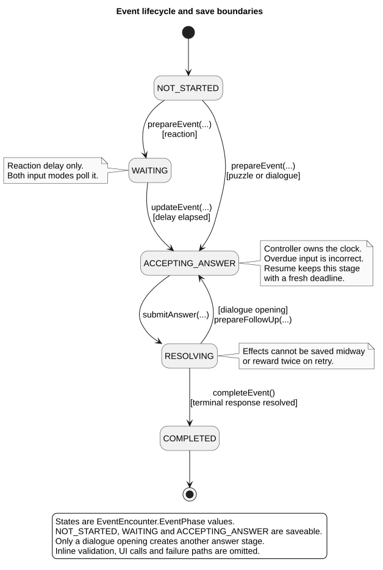

[Editable PlantUML source](diagrams/event-lifecycle.puml).

The diagram uses the actual `EventPhase` values. An event consumes a response before applying
terminal effects, preventing duplicate rewards if a caller retries. An opening dialogue response
creates its follow-up challenge before committing the branch, so a factory failure remains retryable.
Snapshots exclude resolving/completed stages; `resumeEvent(...)` redisplays an active stage without
replaying its earlier response or effects.

| Event | Challenge and matching | Success and failure |
| --- | --- | --- |
| Puzzle | Selected question; answer compared without case or surrounding whitespace; `max(1, 30 + bonusTime)` seconds before mode scaling | Correct: one skill reward, or +20 HP if the pool is empty. Incorrect/late: -2 bonus seconds |
| Reaction | Wait 5,000-29,999 ms, then reveal a command; 2-second base response deadline, mode-scaled; bonus time is not added | Correct and timely: +10 HP. Incorrect/late: 30 damage, clamped at zero |
| Dialogue | Opening `I will not be extorted` uses 10 base seconds; matching starts trade `Show me your rare wares` (10), otherwise escape `flee` (5). All are mode-scaled without bonus time | Trade success: skill or +20 HP; trade failure: -5 bonus seconds. Escape success: no effect; escape failure: 20 damage |

Matching ignores case and surrounding whitespace for all three event types. The controller enforces
`elapsed > required` as failure, including a correct line submitted late in plain mode. Live mode
submits the current buffer at expiry; combat damage still uses that buffer normally, while an
overdue event receives an empty answer. An event's victory flag means the player survived, not
necessarily that the answer was correct: a nonlethal penalty still completes that scenario.

One `RewardPool` is shared across the run. It starts from registered skills minus the player's
owned skill objects, draws without replacement and consumes no randomness when empty. The current
registry therefore awards Overclock once; later successful puzzle/trade rewards heal instead.
HP rewards may exceed starting health and saturate at `Integer.MAX_VALUE`. Penalties and bonuses
carry between scenarios and boss phases and are preserved by run saves.

### Scenario progression and two-phase final boss

#### Run structure and ownership

A run starts with one `Player` at the selected mode's starting HP (100 on Hard), passes through five
regular scenarios with encounter choices and ends with two phases of the Kernel Overlord.
Completing scenario 5 while alive starts the boss rather than winning the run.
Only victory against boss phase 2 triggers the run victory message and return to the main menu.
Player defeat at any point ends the run immediately. A new `start` creates a new player and resets
scenario, phase and challenge state.

`GamePlayState` coordinates progression through one selected `Encounter` or three pending offers;
`CombatEncounter` continues to resolve only one enemy at a time. `scenarioIndex` tracks regular scenario
progress, while `bossPhase` is `0` during regular scenarios and `1` or `2` during the boss. The private
helpers `startScenario()`, `startBossPhase()` and `advanceAfterVictory()` separate encounter creation
from transition decisions. `StateUi.showBossPhase(phase, total)` announces the phase without putting
combat rules into the UI.

The class diagram shows references and creation dependencies during active gameplay; old encounters
are replaced during progression. Target-end role names match stored fields, while dashed arrows
denote temporary dependencies. The diagram omits unrelated UI, skill and clock classes.

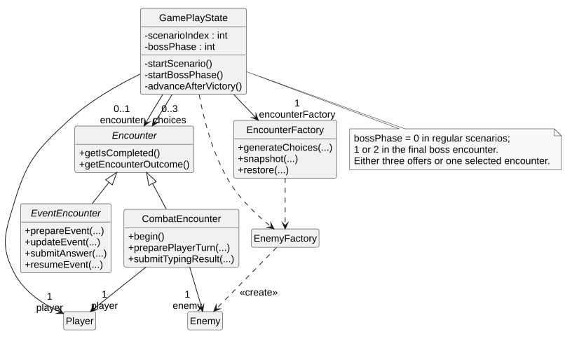

[Editable PlantUML source](diagrams/run-progression.puml).

`EnemyFactory.createRandomEnemy(random, scenarioNumber)` accepts a one-based number from 1 to 5.
It chooses an existing enemy type and skill rotation, then sets health from the scenario table.
Random names therefore retain variety without changing how many successful attacks the balance
target needs. The overloads that create named or unrestricted random enemies remain usable by
sample code and component tests.

`EnemyFactory.createBossPhase(phase)` accepts only phase 1 or 2 and returns a fresh enemy named for
that phase. Phase 1 has 50 HP and a fixed 10-damage attack; phase 2 has 70 HP and a fixed 20-damage
attack. Each phase uses a new `CombatEncounter` with the existing player and shared prompt factory.
The first phase's dead enemy object is not revived or repurposed.

#### Transition ordering and phase boundaries

`CombatEncounter.submitTypingResult(...)` resolves the player's attack first. If enemy HP reaches
zero, it completes victory and returns before executing an enemy turn. Otherwise the enemy attacks;
player defeat is checked before the next turn is offered. `GamePlayState` inspects the completed
encounter and advances only on victory. It does not infer success merely because a challenge ended.

The sequence covers a lethal phase-1 attack through the creation of phase 2. Nested activation bars
follow `resolveAttempt(...)`, `advanceAfterAttempt()`, `advanceAfterVictory()` and `startBossPhase()`;
phase changes are explained in a note rather than appended to a method label.
The factory is a class-level participant and the
new encounter is an object. UI and persistence calls are outside this transition's scope.
Abbreviated constructor arguments include the same player, enemy, UI, shared factory and difficulty.

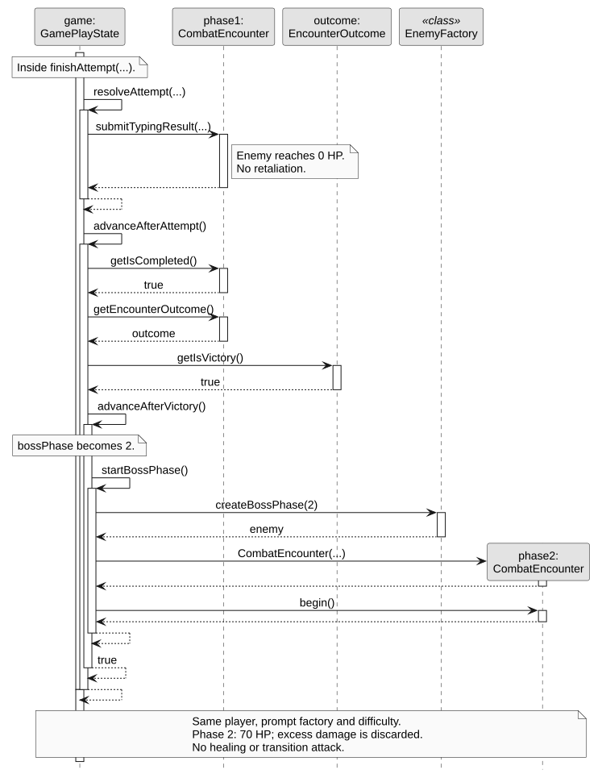

[Editable PlantUML source](diagrams/boss-phase-transition.puml).

The same player reference carries remaining HP, owned skills and bonus time into the next encounter.
Transitions themselves neither heal the player nor trigger an extra enemy attack; event rewards can
heal during encounter resolution. Damage is clamped at zero HP on the current target; any excess is discarded. For example, dealing 60 damage
to a phase with 10 HP remaining defeats that phase, then phase 2 begins with its full 70 HP.
A very strong attack cannot skip phase 2 or immediately win.

A combat timeout uses this same sequence. Nonempty captured input can deal damage, including a lethal
attack. An empty or inaccurate input can deal zero damage and still consume a turn. If the enemy
survives and its response brings player HP to zero, the state returns to the menu without starting
a later scenario or phase.

#### Balance target and verification

The Hard-mode all-combat route has a balance target of 50 WPM and at least 95% character accuracy,
yielding at least 40 damage per attempt. The table counts attacks and possible retaliation at
exactly 40 damage when choosing combat in all five regular scenarios. Regular enemies
retain their usual skill rotation; the highest first attack among those rotations is 20 damage.
Enemies requiring one attack do not retaliate, and those requiring two only use their first attack.

| Encounter | HP | Player attacks | Maximum retaliation damage |
| --- | --- | --- | --- |
| Scenario 1 | 30 | 1 | 0 |
| Scenario 2 | 35 | 1 | 0 |
| Scenario 3 | 50 | 2 | 20 |
| Scenario 4 | 60 | 2 | 20 |
| Scenario 5 | 70 | 2 | 20 |
| Boss phase 1 | 50 | 2 | 10 |
| Boss phase 2 | 70 | 2 | 20 |
| **Total** | | **12** | **90** |

Thus a target-performance all-combat player finishes even the strongest possible regular enemy
selection with at least 10 of the original 100 HP. Random enemy selection cannot invalidate this bound. It is a
balance guarantee for the stated performance, not for arbitrary typing: an additional low-damage
turn can expose a later, stronger enemy skill and lead to defeat. The HP progression introduces
extra turns gradually, and the boss tests the same typing mechanics with a clear phase transition.
Event routes replace regular combats with their own rewards and penalties, so this bound is not a
guarantee for failed event answers or reaction deadlines.

#### Validation, invariants and alternatives

The factory rejects invalid scenario numbers and boss phases with `IllegalArgumentException` and
null random sources with `NullPointerException`. Generated enemies must have positive HP and usable
skill loadouts. Combat entities reject invalid health, and the resolver clamps damage at zero HP.
The encounter guards start/prepare/submit sequencing with exceptions and checks living-participant
assumptions through assertions. State and combat diagnostics remain hidden at normal logging levels.

Progression must preserve these invariants: one live player per run; at most one active challenge;
only a completed survival/victory outcome advances; regular indices stay in the five-scenario range;
boss phase remains 0, 1 or 2; and no run victory occurs before phase 2 is defeated. Resetting all
progression state on entry prevents a new run from inheriting the previous boss phase.

| Choice | Rationale | Alternative considered |
| --- | --- | --- |
| Keep progression in `GamePlayState` | The state already owns the run and its transitions | A separate campaign manager adds another coordinator for a short fixed sequence |
| Reuse `CombatEncounter` per phase | Existing turn ordering and death checks apply unchanged | A special boss encounter subclass duplicates combat logic and increases testing scope |
| Create a fresh enemy for each phase | Fresh HP and loadout have explicit phase boundaries | Mutating a dead enemy risks retaining death flags, pending skills or rotation indices |
| Discard overkill and prohibit transition attacks | Every phase has a predictable initial state | Carrying overflow or adding a transition attack makes timing and difficulty less transparent |
| Set HP by scenario and preserve random identities | Progression is reproducible while encounters remain varied | Unrestricted random HP makes some runs substantially harder at equal typing performance |

### Defensive programming and diagnostics

Assertions expose internal programming errors during development; public validation uses exceptions
and remains active when assertions are disabled. Gradle enables assertions for `run` and `test`,
and the gameplay launchers pass `-ea`. Direct IntelliJ Application configurations should add `-ea`
in **VM options**. See the [README setup steps](https://github.com/AY2627S1-CS2113-W12-4/tp#setting-up-in-intellij).

Diagnostics use `java.util.logging`. Combat events and state transitions use `FINE`, hidden at the
default level. Terminal initialization and input failures use warning or severe levels. This gives
maintainers failure context without filling the typing area with routine debug messages.

## Testing

### Automated checks

Use Java 25 and run `./gradlew check` on macOS/Linux or `.\gradlew.bat check` in Windows PowerShell.
This builds the executable JAR, runs JUnit including packaged-JAR smoke tests, and runs Checkstyle.
Tests are under `src/test/java/seedu/keyboardwarrior`; storage fixtures use `@TempDir` and do not
change the player's records.

| Area | Main tests | Contract checked |
| --- | --- | --- |
| Release startup | `KeyboardWarriorSmokeTest` | Actual JAR launches with redirected input in temporary folders, processes commands and exits on Exit/EOF without the unsupported-console shutdown or native-access warning |
| Plain and live input | `KeyboardWarriorPlainLoopTest`, `StateUiTerminalTest`, `ChallengeClockTest` | Safe delayed-event updates, FIFO EOF/failure handling, interruption, captured live input and countdown placement; simulated terminals use JLine's `exec` provider |
| Typing and damage | Typing-package tests, `SkillResolverTest`, time-bonus tests | Character edits, normalization, code points, invalid inputs, immutable results, fourth-power damage, rounding, late-combat neutrality and signed countdown adjustments |
| Mixed gameplay | `GamePlayStateEventsTest`, event tests, `EncounterSnapshotTest` | Real offer selection, hidden puzzle answers, strict event deadlines, dialogue branches, one-time rewards, healing, remaining reaction waits, RNG preservation and progression into both boss phases |
| Combat progression | `GamePlayStateTest`, `EnemyFactoryTest`, `CombatEncounterTest` | All-combat balance target, scenario HP, retained difficulty, both boss phases, defeat, overkill, rotation and no transition retaliation |
| Persistence and menus | `SaveStoreTest`, `LeaderboardStoreTest`, `GameSaveStoreTest`, `MainMenuStateTest` | Latest-ten retention, best score surviving rotation, tie-breaks, corrupted data, safe file replacement, v1 migration, v2 choices/events/loadouts/bonuses and usable menus after errors |
| Seeded continuation | `RunRandomTest`, save/resume gameplay regressions | Java-compatible random draws, restored prompt history and attack rotation, exact next choices and passages without replaying a turn or reward |

Validation tests also run enemy lookup under a Turkish default locale. Component and simulated
terminal tests complement the acceptance checks below; they do not replace trying the final JAR
in a real terminal on each supported OS.

### ChallengeClock unit tests

[`ChallengeClockTest`](https://github.com/AY2627S1-CS2113-W12-4/tp/blob/master/src/test/java/seedu/keyboardwarrior/typing/ChallengeClockTest.java)
contains the following five tests. Gradle enables assertions during tests.

| Test | Setup and expected result |
| --- | --- |
| `getRemainingSeconds_beforeStart_returnsZero` | Construct a clock without starting it; remaining time is `0`. |
| `start_zeroDuration_returnsZero` | Call `start(0)`; remaining time is immediately `0`. |
| `start_negativeDuration_throwsException` | Call `start(-1)`; expect `IllegalArgumentException`. |
| `getRemainingSeconds_afterExpiry_returnsZero` | Start a one-second timer, wait 1,100 ms, then read twice; both readings are `0`. The extra 100 ms avoids checking exactly at the deadline. |
| `start_calledAgain_replacesDuration` | Start with `0`, restart with `60`, then restart with `0`; readings change to `60` and back to `0`. |

Run just these tests using Java 25:

```powershell
.\gradlew.bat test --tests "seedu.keyboardwarrior.typing.ChallengeClockTest"
```

On macOS/Linux, use `./gradlew` instead of `.\gradlew.bat`.
These tests cover initial state, validation, expiry and restarting. They do not directly test
fractional elapsed-time precision, rounding at an exact second boundary or assertion failures.
The expiry test uses real time, and the immediate 60-second restart check assumes execution is not
paused for a full second between starting and reading. Neither test proves exact scheduling accuracy.
Terminal placement and capture of unfinished input are integration concerns covered by
`StateUiTerminalTest` and the [manual acceptance checks](#appendix-e-instructions-for-manual-testing).

## Maintaining the documentation

The website embeds SVGs generated from the neighboring `.puml` sources with PlantUML. After editing
a source, regenerate and visually check its SVG rather than adjusting activation bars or arrows by
hand. [Diagram maintenance notes](diagrams/README.md) list figure scopes and the rendering command.

When gameplay or storage behavior changes, update the corresponding guide sections, examples and
testing instructions. Rebuild the documentation website and check its links and diagrams before release.

## Appendix A: Product Scope

The target users are players who want terminal-based English and symbol typing practice through
short game encounters. Keyboard Warrior turns speed and accuracy into combat damage, offers puzzles,
reactions and merchant dialogue, and ends a five-scenario run with a two-phase boss.
The product stores one local resumable run, ten recent responses and one all-time best attempt.
Online accounts, network multiplayer and shared online rankings are outside its scope.

## Appendix B: User Stories

| Feature | As a player, I want to ... | So that ... |
| --- | --- | --- |
| Typing feedback | receive character accuracy and WPM feedback | I can identify whether to practise speed or accuracy |
| Typing damage | deal damage from speed and accuracy across all skills | I can understand how my typing affects combat |
| Timed input | have my unfinished text captured automatically at expiry in live mode | I can see my performance even when I cannot finish in time |
| Encounter choices | choose between combat and events in each regular scenario | I can vary the route through a run |
| Event rewards | solve puzzles, react quickly or complete a merchant trade | I can gain a skill or health while risking penalties |
| Overclock | earn extra time through accurate typing | later combat passages become more manageable |
| Combat progression | face higher-HP opponents when I choose combat in later regular scenarios | I can practise sustaining accurate attacks as the run progresses |
| Final boss | fight a final boss with two phases | the run has a clear final challenge before victory |
| Difficulty | choose Easy, Normal, Hard or Coder | health, damage and typing allowances suit my ability |
| Seeds | enter a seed when starting a run | I can repeat random choices with the same gameplay sequence |
| Continue | resume saved choices, combat or an event stage | I can continue practising without losing earned progress |
| Records | review my latest ten attempts in chronological order | I can compare recent typing performance |
| Leaderboard | retain my best attempt across runs and restarts | I have a lasting score to improve on |
| Exit | quit from any menu or gameplay prompt | I can stop the session when I need to |

## Appendix C: Non-Functional Requirements

These are quality targets for the release, with checks that do not require an arbitrary hardware
speed assumption. Functional rules for rewards, progression and Continue are specified separately.

| Quality | Requirement | Acceptance check |
| --- | --- | --- |
| Portability | One executable JAR must launch with Java 25 on Windows, macOS and Linux without Gradle or repository scripts | On each OS, run the same JAR in a terminal and with redirected input; confirm the menu appears and Exit/EOF closes the process normally |
| Reliability | Malformed existing history, high-score or run-save data must produce a loading error without terminating the menu or silently replacing that malformed file | In an isolated folder, test one malformed file of each type, compare its bytes after loading and issue another valid menu command |
| Data integrity | Each destination file must remain untouched until its replacement temporary file is fully written; separate history/high-score writes are not an all-or-nothing transaction | Inject a temporary-write failure and verify that the destination retains its previous bytes; exercise cleanup and replacement tests for each store |
| Input stability | Countdown redraws in live mode must preserve the editable text, including corrections made before submission | Type, use Backspace and retain an unsubmitted line across at least five countdown changes; compare the captured text with the edited line |
| Testability and reproducibility | Typing metrics must be callable with supplied text and times without terminal, clock or file access, and repeated identical inputs must give identical immutable results | Run evaluator fixtures repeatedly, compare every metric, and verify that the returned diagnostic list cannot be modified |
| Working-memory bound | The character-distance dynamic-programming table must use two integer rows of `min(m, n) + 1` cells each, where `m` and `n` are the normalized texts' code-point counts | Inspect `AccuracyCalculator` and test unequal-length inputs in both argument orders; this bound excludes the input/code-point arrays |

## Appendix D: Glossary

* **Gross WPM (words per minute)**: Five normalized submitted UTF-16 code units count as one word, including incorrect input.
* **HP (hit points)**: Remaining health; zero HP ends the player's run or defeats an opponent.
* **Character accuracy**: One minus normalized character edit distance, expressed as a percentage.
* **Edit distance**: Minimum count of character insertions, deletions and substitutions.
* **Overkill**: Damage beyond the current target's remaining HP; discarded at encounter boundaries.
* **Phase**: One boss enemy configuration with its own HP and attack, resolved as one combat encounter.
* **Scenario**: One of five regular stages, completed by surviving the selected combat or event.
* **Bonus time**: A signed run-wide countdown adjustment; added before skill deadline minimums and mode scaling.
* **Checkpoint (stable snapshot)**: Saved choices, a combat turn with no pending attack, or an event stage before its effects are consumed, together with the player's progress. Unfinished typed text is excluded.
* **Seed**: A number or text used to initialize the run's random sequence; repeating a route with the same seed reproduces generated content in the same product version.
* **Live mode**: Terminal input that supports editable countdown redraws and capture of unsubmitted text at expiry.
* **Plain mode**: Complete-line input for consoles without live terminal support; response deadlines are checked when Enter delivers the line, while delayed reaction commands can still appear without Enter.
* **Survival outcome**: An event completes successfully for progression if the player remains alive, even after a wrong answer.

## Appendix E: Instructions for Manual Testing

For the live-countdown checks, use a supported terminal with Java 25 and the release JAR.
The optional `sh ./run-game.sh` or `.\run-game.bat` launchers are alternatives for a source checkout.
Use a fresh temporary working folder for clean-data checks and keep your real `data` directory
separate. Unless stated otherwise choose Hard. To test combat after Start and seed entry, select
encounter `1` before selecting a skill. Test each scenario independently; the event seeds below
refer to a fresh run of this version with no prior random draws beyond normal setup.

| Test | Steps | Expected result |
| --- | --- | --- |
| Standalone JAR launch | Run `java -jar KeyboardWarrior.jar` with only the JAR and Java 25 available | Menu appears without requiring Gradle or a source launcher |
| Redirected launch | Launch the JAR with piped `exit` input, then with empty input | Plain-text menu appears and both runs exit cleanly without terminal setup warnings |
| Plain-mode late input | In an IDE Run console, start a challenge, wait past its displayed allowance and submit a partial passage with Enter | Passage remains visible while waiting; submitted text is scored using actual elapsed time; no empty turn is submitted before Enter |
| Countdown and skill allowance | Start a run; choose each skill across several passages | Timer stays above the passage and updates while typing; ordinary skills use length-based allowances with minimums, while Encryption uses a fixed 60-second base, all scaled by game difficulty |
| Early submission | Submit a partly correct passage before expiry | Four metrics and damage appear; no wrong-word list; surviving enemy retaliates once |
| Timeout capture | Type part of a passage, correct a character, then let time expire without Enter | Final current input is scored; nonempty text has nonzero WPM; no separate late penalty; next input is clear |
| Empty timeout | Enter no text before expiry | Zero WPM, accuracy and damage; a surviving enemy takes its turn |
| Regular progression | Select combat `1` and defeat enemies through scenarios 1 to 5 | HP follows 30, 35, 50, 60, 70; remaining player HP carries; scenario 5 starts boss phase 1 |
| Boss boundary and overkill | Defeat phase 1 with damage exceeding its remaining HP | Phase 2 starts at 70 HP; player HP is unchanged by transition; no extra boss attack; no run victory yet |
| Final victory | Defeat boss phase 2 | Run victory appears and returns to menu |
| Phase-boundary defeat | Reach phase 2 with low HP, then make a nonlethal or empty attempt | Boss response can defeat player; no later phase or victory is announced |
| Restart and exit | Start after victory/defeat; try `exit` during a prompt | New run begins at scenario 1 with the selected mode's starting HP; exit ends the game cleanly |
| Game difficulty | Choose each mode by number or name, then Start | HP is 400/200/100/80; Encryption countdown is 240/120/60/48 seconds; selection persists after a run |
| Seed replay | Record a numeric/text seed, mode, encounter choices, event responses and combat skills/turns; repeat the same route | The same generated content recurs; blank seed input instead generates and displays a fresh seed |
| Continue a current save | Complete a turn, note both HP values, exit, restart from the same folder and enter `5` or `continue` | Saved difficulty, encounter, HP, attack rotation and future random sequence are restored without an extra enemy turn |
| Interrupted passage | Select a skill and type part of its passage; clear the editable line, enter `exit`, relaunch and Continue, then choose the same skill | Previous stable turn is restored with the same passage and a fresh timer; unfinished input is not restored |
| Run completion and save slot | Win or lose, then choose Continue | No active run remains; Records and Leaderboard remain available |
| History and restart | Complete an attempt, enter `exit`, relaunch from the same folder and enter `2` or `records` | Saved WPM and accuracy remain visible; at most the latest ten attempts appear, oldest first; the full menu follows the records |
| Persistent leaderboard | Record a best attempt, then at least eleven lower-WPM attempts; restart from the same folder and enter `6` or `leaderboard` | Exactly one best attempt is shown even though it has left Records; the full menu follows the result |
| Improved best | Beat the stored best WPM, return to the menu and view Leaderboard; restart and view it again | The higher score replaces the old best and persists; exact ties and lower scores do not replace it |
| Menu after empty results | Launch in a fresh temporary working folder, choose a nondefault difficulty, then view Records and Leaderboard | Each empty message is followed by all six menu options and the selected difficulty; Start remains available |
| Menu after loading errors | In an isolated test folder, use malformed history for Records, malformed high-score data for Leaderboard and malformed run data for Continue | Each error is reported and the full menu remains usable; malformed files remain unchanged |

### Encounter and reward checks

| Test | Steps | Expected result |
| --- | --- | --- |
| Offers and invalid input | Start a run; enter `0`, `4`, `Ping` or blank at encounter selection | The same three choices remain available; no combat or timer starts; invalid input does not reroll offers |
| Puzzle and hidden answer | Fresh Start with seed `42`; choose `2`; answer `computer` within its countdown | The computer word scramble appears without disclosing its answer; a correct answer grants Overclock and advances one scenario |
| Puzzle failure | Repeat seed `42`; submit a wrong answer, then repeat and enter `computer` after the displayed deadline | Each attempt applies -2 bonus seconds and no skill reward; survival still advances the scenario |
| Reaction delay and success | Fresh Start with seed `0`; choose `2`; wait without Enter for up to 30 seconds, then enter `roll` promptly | Command appears after the delay; timely matching input grants +10 HP, which can exceed starting HP |
| Reaction failure | Repeat seed `0`; give a wrong response or wait past the command's deadline before Enter | 30 HP is removed; survival advances, zero HP ends the run. In live mode expiry resolves without Enter |
| Plain reaction wait | Run in an IDE Run console; use seed `0` and choose `2`; wait without typing | The command still appears; buffered input is evaluated only after Enter, and a late matching response fails |
| Merchant trade | Fresh Start with seed `3`; choose `2`; enter `I will not be extorted`, then `Show me your rare wares` within each deadline | The second trade stage appears; only its successful response grants Overclock |
| Merchant escape and penalties | Repeat seed `3`; fail the opening and enter `flee` promptly; repeat with a wrong escape. Separately match the opening but fail its trade | Timely escape has no effect; failed escape costs 20 HP; failed trade applies -5 bonus seconds |
| Health fallback | After earning Overclock, successfully solve another puzzle or complete another merchant trade | No duplicate skill is added; the now-empty reward pool grants +20 HP instead |
| Overclock effect | Earn Overclock, choose the next combat `1`, select `Overclock`, then type its passage accurately | Damage uses the usual formula; positive performance adds bonus time, affecting the next skill's displayed allowance |
| Continue offers | Exit at encounter selection, restart in the same folder, choose Continue | Same three offers, mode, progression, HP, skills and bonus time return without new random draws |
| Continue dialogue or puzzle | Exit during an active question or after the merchant opening; Continue | Same question or dialogue branch returns with a fresh response deadline; earlier effects/rewards do not repeat |
| Continue reaction | Exit while waiting for seed `0`'s ambush, then Continue; separately exit after the command appears and Continue | Waiting resumes its saved remaining delay without rerolling; an already revealed command returns with a fresh response deadline |
| Continue earned effects | Earn Overclock and/or healing, exit after the next offers appear, then Continue and select combat | Loadout, bonus time and HP above starting health survive; Overclock remains selectable |
| Mixed route and boss | Complete any five choices, including events; then defeat both boss phases | Exactly five regular scenarios precede phase 1; phase 2 must still be defeated for run victory |

For an all-combat balance check, select encounter `1` in each regular scenario, choose **Hard** and
sustain at least 50 WPM and 95% character accuracy on each
attempt. Confirm at least 40 damage per attack, at most two attacks per regular enemy or boss phase, and at least 10 HP
remaining at victory. Use deterministic automated tests for the strongest regular enemy rotations;
random manual runs demonstrate the flow but cannot establish the worst-case bound by themselves.

### Evaluator component checks

Compile with the Gradle `classes` task, then start Java 25's JShell from the repository folder:

```text
jshell --class-path build/classes/java/main
```

Enter the following commands in JShell. These are interactive statements, not a standalone Java source file:

```text
import seedu.keyboardwarrior.typing.TypingEvaluator;
import seedu.keyboardwarrior.typing.TypingResultFormatter;
var result = TypingEvaluator.evaluateTyping("Strike the goblin", "Strike teh goblin", 6.0, 10.0);
System.out.print(TypingResultFormatter.formatTypingResult(result));
```

Expected: 34.00 WPM, 88.24% accuracy, elapsed 6.00 and required 10.00 seconds. The detailed formatter
still identifies word 2 as expected `the`, typed `teh`. Its positional word diagnostic does not set
the character score. The player damage formula yields 20 for this result on Hard (multiplier 1).
The damage column below also assumes Hard; metrics themselves are independent of game difficulty.

| Typed text (same expected text, six seconds) | WPM | Character accuracy | Player damage |
| --- | --- | --- | --- |
| `Strike the goblin` | 34.00 | 100.00% | 34 |
| `Strike teh goblin` | 34.00 | 88.24% | 20 |
| `Strike the` | 20.00 | 58.82% | 2 |
| `Strike the goblin now` | 42.00 | 80.95% | 18 |
| Empty string | 0.00 | 0.00% | 0 |

Changing only required seconds to `5.0` makes `isTimeLimitExceeded()` true and leaves the metrics and
damage unchanged. Setting required seconds to `6.0` is on time because the comparison is strict.
Zero, negative, NaN and infinite time values should throw `IllegalArgumentException`; null text should
throw `NullPointerException`. Exit JShell with `/exit`.
