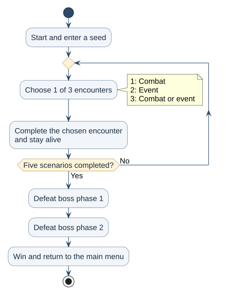

# Keyboard Warrior User Guide

## Introduction

Keyboard Warrior turns typing practice into a terminal adventure. Choose between combat, puzzles,
reaction challenges and a merchant conversation. Complete five regular scenarios, then defeat
both phases of the Kernel Overlord to win. Combat damage depends on typing speed and character
accuracy. Events can award a skill, restore health or reduce the time available in later challenges.

It is for players who want to practice English passages and special characters through a game
and are comfortable opening a terminal. The difficulty settings let you choose a suitable challenge;
Words-per-minute (WPM) and accuracy feedback help you see where to improve.

Health points (HP) and earned effects carry through the run. Choose Easy, Normal, Hard or Coder difficulty,
replay a seed, and continue saved progress. Records retains your latest ten typing responses;
Leaderboard keeps your best response across runs.

## Contents

- [Quick Start](#quick-start)
- [Features](#features)
  - [Command conventions](#command-conventions)
  - [Starting a new run](#starting-a-new-run)
  - [Main menu and game difficulty](#main-menu-and-game-difficulty)
  - [Encounter choices and events](#encounter-choices-and-events)
  - [Skills and countdown](#skills-and-countdown)
  - [Combat and progression](#combat-and-progression)
  - [Seeds and repeatable runs](#seeds-and-repeatable-runs)
  - [Saving and continuing a run](#saving-and-continuing-a-run)
  - [Saved typing history](#saved-typing-history)
  - [Leaderboard](#leaderboard)
  - [Typing feedback](#typing-feedback)
  - [Exiting the game](#exiting-the-game)
- [FAQ](#faq)
- [Known issues](#known-issues)
- [Command summary](#command-summary)

## Quick Start

1. Install **JDK 25**. Run `java -version` in a terminal to confirm version 25.
2. Download the JAR from the [releases page](https://github.com/AY2627S1-CS2113-W12-4/tp/releases).
   Put it in a writable folder and open a terminal there.
3. Run `java -jar "KeyboardWarrior.jar"`. Substitute your downloaded filename if it differs.
   The same JAR runs on Windows, macOS and Linux; Gradle and the source project are not required.
4. Enter `start`, then a seed such as `42`, or press Enter on an empty seed line for a random run.
5. At `Choose your encounter`, enter `1`, `2` or `3`. Choice 1 is combat, choice 2 is an event,
   and choice 3 may be either.
6. In combat, enter a displayed skill name such as `Ping`, then type its passage. For an event,
   follow its question or displayed response instructions. Press Enter to submit.
7. Complete five scenarios and both boss phases. Enter `exit` to quit; use `continue` at the
   main menu when you return.



Repeat the encounter choice for each scenario. Both boss phases are required afterward;
losing all HP ends the run at any point.

Use a native terminal, Windows Terminal or IntelliJ's Terminal for a live countdown that captures
unfinished input at expiry. The timer appears above the typing instructions. Corrections made
before submission or expiry count; mistakes you already corrected do not affect the result.

If the console redirects input/output or cannot redraw its input line, the game automatically
uses plain-text mode. It prints the allowance once and waits for Enter. Reaction commands still
appear after their waiting period without requiring an extra Enter. Plain mode cannot capture
unfinished text or submit it automatically. Late combat input still deals damage from its measured
speed and accuracy; a late event response fails that event stage.

For a source checkout, optional launchers are `sh ./run-game.sh` on macOS/Linux and
`.\run-game.bat` in Windows PowerShell. They compile through Gradle and start Java directly.
They are not needed for a downloaded release.

## Features

### Command conventions

- Type each command or response and press Enter. In examples, enter each line separately
  when the corresponding prompt appears.
- Commands depend on the current prompt. For example, `2` opens Records at the main menu,
  selects Normal at difficulty selection, and selects the event at encounter selection.
- Menu names, difficulty names and skill names ignore capitalization and surrounding spaces.
  For example, `START` and `start` work alike at the main menu.
- Combat accuracy counts capitalization and punctuation. Event answers accept matches without
  regard to capitalization or surrounding spaces, but their accuracy score still counts case.
- `exit` is reserved for quitting at every input prompt, including a seed or typing challenge.
  It is not submitted as a scored response. There is no manual `save` command.

### Starting a new run

**Where:** Main menu. **Format:** `start` or `1`, followed by a seed at the next prompt.

Example:

```text
start
42
```

This starts scenario 1 with seed `42` and the currently selected difficulty. Press Enter on an
empty seed line for a random seed, or use text such as `practice-run`. See
[Seeds and repeatable runs](#seeds-and-repeatable-runs) for replay behavior.

> **Starting a new run replaces your previous saved run without asking for confirmation**
> once the new encounter choices are successfully saved. Choose `continue` instead to resume
> existing progress. Records and Leaderboard are retained.

### Main menu and game difficulty

**Where:** Main menu. **Format:** `choose difficulty` or `4`, followed by a displayed mode's
name or number.

Example: enter `choose difficulty`, then `easy` (or `1`). You return to the main menu with Easy
selected; enter `start` to begin a new run in that mode.

Choose Difficulty offers these modes, numbered 1 to 4 in the order below:

| Game difficulty | Player damage multiplier | Countdown multiplier | Starting HP |
| --- | --- | --- | --- |
| Easy | x4 | x4 | 400 |
| Normal | x2 | x2 | 200 |
| Hard (default) | x1 | x1 | 100 |
| Coder | x0.8 | x0.8 | 80 |

In this guide, **base seconds** means the time before applying the countdown multiplier.
For example, a two-second base allowance becomes four seconds on Normal.

The mode appears in the main menu and at the start of the run. Countdowns round up to whole
seconds after scaling. Enemy HP and enemy attack damage do not scale with the mode. Reaction
waiting periods are unchanged; their response deadlines do scale.

Selection remains active after victory or defeat in the current session. Restarting defaults new
runs to Hard. Continue restores the saved run's own mode, even if you selected another in the menu.
Difficulty does not alter recorded WPM or accuracy.

### Encounter choices and events

**Where:** `Choose your encounter` prompt. **Format:** `1`, `2` or `3`.

Example: enter `2` to begin the displayed event, then follow its instructions below.

Each regular scenario offers three numbered encounters. You play only the one you select.
Choice 1 is combat, choice 2 is an event, and choice 3 is randomly combat or an event. An event
may be a puzzle, a sudden ambush or a suspicious merchant. After the selected encounter finishes
and you are still alive, the next scenario begins.

An incorrect or late event answer can still let you advance if you survive its penalty. Events
do not cause a separate combat enemy to attack. A merchant conversation counts as one scenario,
even though it contains two responses.

#### A Mysterious Puzzle

Solve the displayed question and enter your answer before its deadline. Questions include riddles,
word scrambles, sequences and decoding problems. The expected answer is deliberately hidden.

A correct, on-time answer awards an unowned skill. With the starting loadout, the available reward
is **Overclock**. Once you own all reward skills, a correct puzzle instead restores **20 HP**.
An incorrect, empty or late answer reduces the accumulated allowance for future combat and puzzle
challenges by **2 base seconds**. The puzzle then finishes.

The initial allowance is 30 base seconds, adjusted by your accumulated time bonus or penalty and
then multiplied by game difficulty. At least one base second is available before scaling.

#### A Sudden Ambush

Wait when the game displays `Something's afoot. Look out for danger...`. After a random wait of
5 to just under 30 seconds, a command such as `TYPE 'DODGE' NOW` appears. Enter that command before
its response deadline. Premature input does not answer the event; `exit` still quits.

An on-time matching response restores **10 HP**. An incorrect, empty or late response deals
**30 damage** to you. Surviving completes the scenario.

| Mode | Time to respond after the command appears |
| --- | --- |
| Easy | 8 seconds |
| Normal | 4 seconds |
| Hard | 2 seconds |
| Coder | 2 seconds |

Accumulated time bonuses do not alter the wait or response deadline. The command appears
automatically in both live and plain-text modes. In plain mode, press Enter promptly: the same
deadline applies even though the game cannot auto-submit your unfinished response.

#### A Suspicious Merchant

Type the displayed response for each stage:

1. The opening asks you to stand your ground: `I will not be extorted`.
2. An on-time matching opening leads to a trade: `Show me your rare wares`. An incorrect or late
   opening leads to the guard escape response: `flee`.

A successful trade awards an unowned skill, or **20 HP** when no reward skills remain. Failing
or missing the trade reduces future combat and puzzle allowances by **5 base seconds**. A
successful escape has no health or skill effect; failing or missing it deals **20 damage**.
Surviving either branch completes the scenario.

| Response | Easy | Normal | Hard | Coder |
| --- | --- | --- | --- | --- |
| Opening or trade | 40 seconds | 20 seconds | 10 seconds | 8 seconds |
| Escape | 20 seconds | 10 seconds | 5 seconds | 4 seconds |

Accumulated time bonuses and penalties do not change these conversation deadlines.

#### Rewards and health

Each reward skill is granted once per run. Overclock remains available in later fights and both
boss phases after you earn it. Successful puzzles and trades offer healing after all reward skills
are owned. Healing can raise your HP above its initial value.

There is no automatic healing between scenarios or boss phases. Remaining HP, learned skills and
time adjustments carry forward. They reset when you start a new run.

### Skills and countdown

**Where:** Combat skill selection. **Format:** a displayed skill name, such as `Ping`.

Example: enter `Ping`, then type the passage shown and press Enter. Enter the skill name only
at skill selection; typing it during an active challenge submits it as your response instead.

In combat, enter a skill's displayed name. Five starting skills are always available; Overclock
becomes available after a puzzle or trade awards it.

| Skill | Passage difficulty | Initial base allowance on Hard |
| --- | --- | --- |
| `Ping` | Easy | At least 15 seconds |
| `Brute Force` | Medium | At least 30 seconds |
| `Buffer Overflow` | Hard | At least 30 seconds |
| `SIGKILL` | Ultimate | At least 45 seconds |
| `Encryption` | Random special characters | 60 seconds |
| `Overclock` (earned) | Easy | At least 15 seconds; adds time for later challenges |

For ordinary passages, the game allows the greater of the listed minimum and the time needed to
type the normalized character count at 50 WPM with a 20% buffer. It adds your accumulated time
adjustment, keeps at least 10 base seconds, then applies the mode's multiplier. Check the displayed
allowance for each attempt.

Encryption generates symbols from `!@#$%^&*()\_+/*{}|:"<>?`, grouped into one to six characters.
The passage is approximately as long as a SIGKILL passage. Before earned bonuses or penalties,
its allowance is 240 seconds on Easy, 120 on Normal, 60 on Hard and 48 on Coder. Your accumulated
adjustment changes its 60-second base before difficulty scaling.

Every player skill uses the same combat damage formula. Overclock also adds time for future
combat and puzzle challenges according to typing performance:

```text
Added base seconds = floor(20 * (WPM / 50) * (accuracy percentage / 100)^4 * game difficulty multiplier)
```

On Hard, a 50 WPM, 100% accurate Overclock attack deals 50 damage and adds 20 base seconds. At
50 WPM and 95% accuracy, it deals 40 damage and adds 16 base seconds. Repeated uses accumulate;
puzzle and merchant penalties subtract from that same total. The bonus changes later challenges,
not the one just completed, and is scaled with the next challenge's difficulty. It does not extend
reaction or merchant deadlines.

### Combat and progression

Combat shows the enemy's HP and your skills. Choose a skill, type its passage and submit.
Feedback shows WPM, character accuracy, elapsed time, required time and damage; individual wrong
words are not listed. A surviving enemy uses its next attack before your next skill choice.
A defeated enemy does not retaliate.

If you choose combat, enemy HP depends on the scenario. Events also advance scenarios, so a run
need not contain five regular fights.

| Encounter | Starting enemy HP if combat is chosen | What follows completion |
| --- | --- | --- |
| Scenario 1 | 30 | Choose an encounter for scenario 2 |
| Scenario 2 | 35 | Choose an encounter for scenario 3 |
| Scenario 3 | 50 | Choose an encounter for scenario 4 |
| Scenario 4 | 60 | Choose an encounter for scenario 5 |
| Scenario 5 | 70 | Start the final boss |
| Kernel Overlord, phase 1 | 50 | Start phase 2 |
| Kernel Overlord, phase 2 | 70 | Win the run |

When the boss survives your attack, it retaliates for 10 damage in phase 1 or 20 damage in
phase 2. Defeating either phase does not trigger retaliation from that defeated phase.

Regular combat varies enemy names and attack rotations. Passages vary within their difficulty,
without immediately repeating the previous passage of that difficulty. Enemies, events and
passages can reappear later.

Damage beyond an enemy's remaining HP is discarded. It does not carry to the next scenario or
boss phase. A phase transition neither heals you nor grants the boss an extra attack. Both boss
phases are mandatory after the five regular scenarios; beating phase 1 alone does not win.

For an all-combat route on Hard, 50 WPM and at least 95% character accuracy yield at least 40 damage
per attack. Each enemy and boss phase then takes at most two attacks, and even the strongest
regular rotations leave at least 10 HP after victory. Event routes can change health and allowances;
this combat-route example does not guarantee an event outcome.

If your HP reaches zero in combat or an event, the run ends immediately. Victory or defeat returns
to the main menu. Start begins a fresh run at scenario 1 using the selected mode.

### Seeds and repeatable runs

A seed controls encounter offers, enemy and event content, rewards, reaction waits and combat
passages. After Start, enter:

* A signed 64-bit whole number, such as `42` or `-19`, to use that exact number.
* Nonblank text, such as `practice-run`, to convert it consistently into a numeric seed.
* An empty line to generate and display a random numeric seed.

`exit` remains reserved for quitting, including at the seed prompt.

Reusing a seed repeats choices with the same selections, responses and event outcomes in the same order.
Different encounter selections, skills or event rewards can change later choices. All three offers
are generated before selection, so unselected offers can affect that sequence too. Seeds are for
repeatable gameplay and testing.

Continue retains displayed offers and selected event content instead of drawing new choices.
It also preserves future selections and the previous combat passages used to avoid immediate
repeats. You do not re-enter the seed. Older combat-only saves still load; saves without random
selection information continue with a fresh random sequence.

### Saving and continuing a run

**Where:** Main menu. **Format:** `continue` or `5`.

There is one slot at `data/game-save.properties`, relative to the folder where you launch the JAR.
Progress saves when choices appear, when you select an encounter, after a completed combat turn
and between event response stages. Rewards and penalties are saved with that progression.

To leave and return later:

1. Enter `exit`.
2. Launch the JAR again from the same folder.
3. Enter `5` or `continue` at the main menu.

The game restores difficulty, HP, owned skills, accumulated time adjustment and position in the
run. A saved choice menu shows the same three offers. Combat restores enemy HP and the next enemy
attack without an extra turn. A puzzle restores its question; a merchant restores the current
opening, trade or escape stage without granting another copy of an earlier reward.

Unfinished text and the response timer are not saved. An interrupted combat challenge returns to
skill selection; an active event response is shown again with a fresh deadline. Choosing the same
combat skill reproduces the interrupted passage after continuing a current save.

During a reaction wait, Exit records the remaining wait. Continue resumes that saved wait; time
spent with the application closed does not consume it. Abruptly closing the terminal can instead
restore the earlier autosaved waiting point.

Older combat-only saves resume that fight with the starting loadout and no earned time adjustment.
They acquire the current save behavior when progress saves again. Do not edit save contents;
malformed, unsupported or unreadable saves produce an error without starting a run.

Start replaces the previous slot without confirmation when its new offers are successfully saved.
Winning or losing removes the active save; Records and Leaderboard remain. There is no manual
save command. A saving failure
shows an error and play continues; until a later save succeeds, Continue can restore only the last
successful checkpoint. Failure to remove a finished save is also reported.

### Saved typing history

**Where:** Main menu. **Format:** `records` or `2`.

Example: enter `records` after a completed challenge to see your latest results.
The list contains the latest ten typing responses, oldest first.
Each is one combat passage or timed event response, not a whole game. A two-stage conversation
produces two entries. Reaction waiting and menu selections do not create typing records.

Records shows WPM and character accuracy. The `#` column is its displayed position, not a permanent
ID or score rank. Automatic live-timer submissions, including empty responses, are also recorded.
The full menu reappears afterward, keeping the selected difficulty.

History is stored in `data/keyboardwarrior.txt` and survives restarts. Empty history produces a
message. Invalid or unreadable history produces an error and returns to the menu. A saving error
does not stop combat or an event, but that response may be missing from Records.

### Leaderboard

**Where:** Main menu. **Format:** `leaderboard` or `6`.

Example: enter `leaderboard` to see the single all-time best response. Ranking uses
**highest WPM**, then higher character accuracy to break WPM ties. There is no minimum accuracy
requirement. Exact ties keep the existing best. Combat and event responses across all modes and
seeds share this local board; it is not a total-damage or whole-run score.

The best is stored in `data/keyboardwarrior.txt.high-score`. It survives restarts and removal of
older entries from the ten-response history. Only a better response replaces it. When no high
score exists, existing history supplies its initial best; discarded responses cannot be recovered.
Metrics display two decimal places, but comparisons use full precision, so entries that look equal
can rank differently.

An empty leaderboard produces a message. Unreadable or malformed data produces an error; initial
loading can also fail if history is unreadable or the first high score cannot be saved. The full
menu reappears after results or errors, retaining the selected difficulty.

### Typing feedback

#### Words per minute (WPM)

Gross WPM uses five characters as one word:

```text
WPM = (normalized submitted characters / 5) / (elapsed seconds / 60)
```

Leading/trailing whitespace is removed and repeated internal whitespace becomes one space.
Remaining letters, punctuation and spaces count; Enter does not. Incorrect characters count
toward gross WPM, so read it alongside accuracy. Empty or whitespace-only input gives 0 WPM.

#### Character accuracy

Accuracy uses the fewest single-character insertions, deletions and substitutions needed to
change normalized expected text into normalized input:

```text
Accuracy % = 100 * (1 - edit distance / longer normalized text length)
```

Capitalization and punctuation count for this score, including when an event accepts an answer
without regard to case. Matching text scores 100%; empty input scores 0%. One missing character
does not shift every later character into an error. Only the final text is scored.

An event may therefore accept a case-insensitive match while showing less than 100% accuracy.
Puzzles require solving their question; copying a displayed combat passage is not the task there.

#### Damage and the deadline

Combat damage is:

```text
Damage = floor(WPM * (accuracy percentage / 100)^4 * game difficulty multiplier)
```

`floor` rounds down once after the multiplier. On Hard, 50 WPM and 100% accuracy deal 50 damage;
50 WPM and 95% accuracy deal 40; 50 WPM and 80% accuracy deal 20. At 50 WPM and 95% accuracy,
damage is 162 on Easy, 81 on Normal, 40 on Hard and 32 on Coder. All combat skills use this
formula; enemy attacks use fixed damage.

Combat has no separate damage deduction for exceeding its allowance. Its submitted text and
actual elapsed time still determine speed and accuracy. **A late event response fails its stage**,
even if otherwise correct. Feedback still records the text you submitted.
An answer measured exactly at its allowance is on time; it is late only when elapsed time is greater.

Live expiry announces `Time's up!`, captures input and resolves the attack or event response.
Plain mode waits for Enter, then checks elapsed time. Metrics display two decimal places;
calculations use full values.

#### Illustrative scoring example

This is a hypothetical calculation, not a passage or deadline you can select in the game.
Suppose a Hard combat challenge expects `Strike the goblin` with a 10-second allowance.
Submitting `Strike teh goblin` in 6 seconds gives:

```text
WPM: 34.00
Accuracy: 88.24%
Elapsed time: 6.00 seconds
Required time: 10.00 seconds
```

The swapped letters need two edits. Damage is **20** after the formula and rounding. Correct text
in six seconds gives **100.00% accuracy** and **34 damage**. If the hypothetical allowance were
five seconds and plain mode accepted that response after six seconds, it would be late without
an additional combat damage penalty. A late event response instead fails its stage.

### Exiting the game

**Where:** Any input prompt. **Format:** `exit`; `3` also quits at the main menu.

Example: enter `exit` at combat skill selection, then relaunch from the same folder and enter
`continue` to resume the saved fight. The application closes rather than returning to the menu.
Progress is saved automatically at checkpoints; unfinished text is not saved. See
[Saving and continuing a run](#saving-and-continuing-a-run) for event and timer behavior.

## FAQ

**How do I move my progress to another computer?**
Copy the `data` folder into the folder from which you will launch the JAR on the other computer.
It contains the active run, recent typing history and best response. Launching from another folder
uses separate data, even if you run the same JAR.

**Why did Continue ignore the difficulty I just selected?**
Continue restores the saved run's own difficulty. Menu selection applies to a new run.

**Why can I not choose Overclock?**
Earn it through a successful puzzle or merchant trade first. It then appears at combat skill
selection and remains available for the rest of that run.

**Why is a faster response ranked above a more accurate one?**
Leaderboard ranks by WPM first and uses accuracy only to break WPM ties. Combat damage also
depends strongly on accuracy, so the highest-ranked response need not deal the most damage.

**Why does a correct event answer fail, or show less than 100% accuracy?**
A correct answer submitted after the deadline fails. An on-time answer can succeed despite
capitalization differences, while the character accuracy score still counts those differences.

<a id="troubleshooting-and-data-files"></a>

## Known issues

The main terminal limitation and common setup or data problems are listed below.

| Problem | What to do |
| --- | --- |
| The JAR does not start | Run `java -version` and select JDK 25. Open a terminal in the JAR's folder and use its actual filename. |
| No live countdown appears | The game is in plain mode. Use a native terminal or IntelliJ's Terminal for live capture, or submit with Enter. |
| A reaction command has not appeared | Wait for the ambush delay. Do not answer before its command is revealed. |
| A correct event answer failed | Check its deadline. In plain mode, time runs until Enter. |
| A skill name is rejected | Enter a displayed skill at combat skill selection. Overclock must be earned first. |
| An encounter is rejected | Enter one of the displayed numbers, 1 to 3. Skill names do not select encounters. |
| Records, Leaderboard or Continue is empty | Launch from the same folder used previously. |
| Saving or loading reports an error | Check that the folder and `data` are writable/readable. Back up data before replacing or removing damaged files. |

The files are `data/game-save.properties`, `data/keyboardwarrior.txt` and
`data/keyboardwarrior.txt.high-score`. Keep `data` with the game when moving saved progress.
Different launch folders have separate progress, history and leaderboards.

<a id="command-reference"></a>

## Command summary

Submit each command or response with Enter. See [Command conventions](#command-conventions)
for capitalization and input-stage rules.

| Where you are | Input | Result |
| --- | --- | --- |
| Main menu | `1` or `start` | Ask for a seed, then begin a new run |
| Main menu | `2` or `records` | Show the latest ten typing responses |
| Main menu | `3` or `exit` | Quit |
| Main menu | `4` or `choose difficulty` | Open difficulty selection |
| Main menu | `5` or `continue` | Resume the saved run |
| Main menu | `6` or `leaderboard` | Show the single all-time best response |
| Difficulty selection | `1` / `easy`, `2` / `normal`, `3` / `hard`, `4` / `coder` | Select a mode and return to the main menu |
| Seed prompt | A number, nonblank text or an empty line | Use that seed, convert the text into a seed or generate one |
| Encounter selection | `1`, `2` or `3` | Start that displayed choice |
| Combat skill selection | A displayed skill name | Start its typing challenge |
| Active combat challenge | Your typed passage | Submit that attack |
| Active event challenge | Your answer or the displayed response | Resolve that event stage |
| Reaction waiting period | Wait for the command | Respond after it appears |
| Any phase | `exit` | Quit the application |

Numbers have meaning only in their displayed menu. For example, `3` selects the third encounter
at an encounter prompt; it quits only at the main menu. Invalid encounter input leaves the same
three choices available. There is no manual `save` command.
